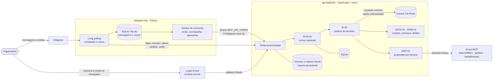

# Compra com Contexto

**Agente conversacional para organizar compras em grupo no iFood**, respeitando as restrições alimentares e o orçamento de cada pessoa. Projeto do Hackathon SEMCOMP × iFood 2026 — equipe Modo Escuro.

O produto é formado por dois repositórios que funcionam juntos:

| Repositório | Papel | Tecnologia |
| --- | --- | --- |
| **[api-backend](https://github.com/Modo-Escuro/api-backend)** (este) | Cérebro e autoridade: login iFood, agente Gemini, regras de restrição e orçamento, propostas, persistência e acesso ao MCP | Node 22 + TypeScript + Hono, SQLite |
| **[telegram-bot](https://github.com/Modo-Escuro/telegram-bot)** | Interface do organizador: recebe mensagens, mostra respostas e botões, guarda a fila de mensagens; não tem regras de compra nem tokens iFood | Python 3.12, long polling, SQLite |

> **Fronteira atual.** Decisão vigente ([DEC-01 D8](docs/decisoes-conversacionais.md)): carrinho real **somente após confirmação humana específica** do organizador; envio de pedido e pagamento proibidos. Código na `main`: o MCP é usado **somente para leitura** e a composição escolhida é uma **sacola simulada** — a preparação do carrinho real está no PR rascunho [#46](https://github.com/Modo-Escuro/api-backend/pull/46), desligada por padrão. Login não aprova compra. Detalhes em [estado remoto/local](docs/estado-remoto-local.md).

- **Entregáveis do hackathon:** [entrega/entregaveis.tex](entrega/entregaveis.tex) (LaTeX/Overleaf; [instruções](entrega/README.md))
- **Roteiro do pitch:** [entrega/pitch.md](entrega/pitch.md)
- **Índice técnico:** [docs/README.md](docs/README.md) · [Plano vigente](docs/plano-conversacional.md) · [Estado remoto/local](docs/estado-remoto-local.md) · [Decisões vigentes](docs/decisoes-conversacionais.md)

## Problema e proposta de valor

Quem organiza um pedido coletivo precisa juntar, por mensagem, quem vai comer, quem tem alergia, quem é vegetariano, quanto cada um pode gastar e qual loja atende a todos — e depois conferir preços e dividir a conta. Erros aqui custam caro: uma alergia esquecida ou um total que estoura o limite de alguém.

O Compra com Contexto transforma essa coordenação em uma conversa. O organizador descreve o grupo em linguagem natural; o agente registra participantes, restrições e tetos, busca ofertas reais no iFood, monta até 4 propostas com **cobertura por pessoa** e explica o que não pôde ser verificado. Regras de segurança (alergias, tetos, valores desconhecidos) ficam no servidor, não no modelo de linguagem.

## Funcionalidades e estado

Estado conferido em 18/10/2026: API `main@8a6dadc` e bot `main@d239edd`. "Na main" significa código integrado; **não** implica deploy ou flag ativa.

| Funcionalidade | Estado | Referência |
| --- | --- | --- |
| Login iFood (OAuth 2.1 + PKCE + PAR) vinculado ao Telegram | Na main (API e bot). **Ensaiado online** em 17/10/2026 na versão com botão de confirmação. Desde o PR [#45](https://github.com/Modo-Escuro/api-backend/pull/45), o retorno do navegador conclui o vínculo sem segundo clique; esse novo retorno ainda não foi ensaiado online | [bot-api](docs/bot-api.md), [retorno natural](docs/login-retorno-natural.md), [login no bot](https://github.com/Modo-Escuro/telegram-bot/blob/main/docs/login-ifood.md) |
| Conversa por texto livre no Telegram, com fila durável, `/andamento`, `/interromper`, `/retomar` e retomada do grupo após o login | Na main do bot; opt-in (`TELEGRAM_CONVERSATION_ENABLED`). **Ativada em produção** em 18/10/2026 junto com o Gemini (bot `9314c72`, API `28edd06`), conforme o [registro de ativação](https://github.com/Modo-Escuro/telegram-bot/blob/main/docs/ensaio-bot02-operacional.md); ensaio humano completo ainda não registrado | [BOT-01](https://github.com/Modo-Escuro/telegram-bot/blob/main/docs/bot-01-fila-duravel.md), [BOT-02](https://github.com/Modo-Escuro/telegram-bot/blob/main/docs/bot-02-retomada-contexto.md) |
| Entrada na demo por senha, com conversa e vínculo isolados por conta Telegram | Na main (API #39, bot #13/#14); opt-in | [acesso-bot-senha](docs/acesso-bot-senha.md), [acesso no bot](https://github.com/Modo-Escuro/telegram-bot/blob/main/docs/acesso-senha.md) |
| Assistente **Ailo**: menu de botões, respostas mais curtas, indicador "digitando" | Na main do bot (#15 e `4f47406`); **sem deploy registrado** | [conversa por botões](https://github.com/Modo-Escuro/telegram-bot/blob/main/docs/conversa-por-botoes.md), [Ailo](https://github.com/Modo-Escuro/telegram-bot/blob/main/docs/ailo-voz.md) |
| Mensagens de voz transcritas (Groq `whisper-large-v3-turbo`), com "Ouvi: …" para conferência | Na main do bot; **desligada por padrão** (`TELEGRAM_VOICE_ENABLED=false`); testada só com áudio sintético | [Ailo e voz](https://github.com/Modo-Escuro/telegram-bot/blob/main/docs/ailo-voz.md) |
| Vínculos persistentes, backup e restauração | Na main | [OPS-01](docs/ops-01-persistencia.md) |
| Recomendação explicada (`/api/evaluate`): busca, `getItem`, restrições tri-estado, preço composto, ranking D9 | Na main | [RANK-03](docs/rank-03-contrato-v2.md), [pricing-audit](docs/pricing-audit.md) |
| Dinheiro em centavos inteiros, limites locais e rateio exato | Na main | [DOM-01](docs/dom-01-centavos-limites.md) |
| Conversa durável (turnos idempotentes, fila, recuperação após queda) | Na main; opt-in, desligada por padrão | [RUN-01](docs/runtime-turnos.md) |
| Compra, participantes e restrições persistidos com versão e exclusão em 24 h | Na main | [DATA-01](docs/data-01-compra.md) |
| Agente com vocabulário fechado de ações, sobre Gemini 3.8 Flash | Na main; opt-in separado; avaliado só com dados sintéticos | [AI-02](docs/ai-02-agente.md), [AI-01](docs/ai-01-montagem-ensaio.md) |
| Propostas coletivas com cobertura por pessoa e composição escolhida (sacola simulada, sem escrita no iFood) | Na main | [GRP-01](docs/grp-01-propostas.md) |
| Logs sanitizados, métricas, orçamento do modelo, status operacional | Na main (parcial) | [OPS-02](docs/ops-02-operacao.md) |
| Preparar carrinho real no iFood após confirmação humana (`PREPARE_CART`, CART-01) | **Decisão adotada** na DEC-01 ([#43](https://github.com/Modo-Escuro/api-backend/pull/43), mergeado). **Código em PR rascunho** [#46](https://github.com/Modo-Escuro/api-backend/pull/46), desligado por padrão (`IFOOD_CONFIRMED_CART_WRITES_ENABLED=false`); botões no Telegram (BOT-03) e validação de saídas reais (INT-02 #40) pendentes. **Não disponível na demo** | [DEC-01](docs/decisoes-conversacionais.md), [estado remoto/local](docs/estado-remoto-local.md) |
| Aprovação de pedido, envio e pagamento | **Proibidos** neste incremento; `/purchase-approvals` responde `ACTION_UNAVAILABLE`; bloqueados no gateway, nas rotas e no lint. F7 legada desligada (`IFOOD_CART_ENABLED=false`) | [DEC-01](docs/decisoes-conversacionais.md), [F7](docs/f7-cart-checkout.md), [INT-01](docs/int-01-audit.md) |

## Arquitetura



**Divisão de responsabilidades.** O bot valida que a mensagem veio de uma conversa privada autorizada, guarda a mensagem numa fila antes de enviá-la (para não perdê-la se o processo cair) e transforma a resposta da API em texto. Ele não interpreta o pedido, não conhece regras de alergia ou orçamento e nunca vê tokens do iFood. A API concentra autenticação, agente, regras, cálculo e acesso ao iFood.

O modelo **propõe** ações (ex.: `ADD_RESTRICTION`, `SET_LIMIT`, `SUGGEST_PROPOSALS`); o servidor valida cada uma contra o estado gravado e só aplica o que o domínio aceita. O modelo não recebe tokens, endereço, identidade Telegram nem IDs de conta, e não tem ação de aprovação ou envio.

## Stack

- **Node.js ≥ 22.13** + TypeScript (strict), **Hono** (`@hono/node-server`)
- **SQLite nativo** (`node:sqlite`) para turnos e compra
- `@modelcontextprotocol/sdk` (Streamable HTTP + OAuth) para o iFood MCP
- Vercel AI SDK (`ai`, `@ai-sdk/google`) para o Gemini; `zod` para schemas estritos
- React + Vite (página de diagnóstico da integração, não é a interface da demo)
- Vitest, ESLint; CI em Ubuntu/Windows × Node 22.13/24
- Bot ([telegram-bot](https://github.com/Modo-Escuro/telegram-bot)): Python 3.12, biblioteca padrão para HTTP, `jsonschema` para validar o contrato v1.0, SQLite; CI Windows/Linux com testes HTTP contra rotas reais da API em loopback

## Estrutura do repositório

```
src/server/
  index.ts, app.ts, config.ts   # entrypoint, rotas, configuração
  auth.ts, botAuth.ts, links/    # OAuth, autenticação do bot, vínculos por organizador
  mcp/                           # cliente MCP e wrappers tipados de leitura
  domain/                        # funções puras: preço, restrições, ranking, grupo, centavos
  services/                      # avaliação e geração de propostas (leitura MCP)
  turns/, contracts/             # runtime RUN-01 e contrato de conversa v1.0
  agent/                         # processador AI-02 e adaptador Gemini
  ops/                           # logs, métricas, orçamento do modelo
  cart/                          # F7 legada (desligada)
src/web/                         # página React de diagnóstico
test/                            # Vitest (fixtures reais sanitizadas + fakes)
fixtures/                        # respostas reais do MCP salvas para testes offline
scripts/                         # avaliação do agente, auditoria, administração de vínculos
docs/                            # documentação técnica e entregáveis
```

## Pré-requisitos

- Node.js 22.13 ou superior e npm
- Client OAuth do iFood MCP com `redirect_uri` cadastrado (o AS compara literalmente)
- Para a conversa: bot Telegram configurado ([telegram-bot](https://github.com/Modo-Escuro/telegram-bot)) e chave da API Gemini

## Instalação e execução local

```bash
npm ci
cp .env.example .env      # preencher as variáveis (ver abaixo)
npm run dev               # API em :8000 + Vite em :5173
npm start                 # somente a API
```

## Configuração de ambiente

Todas as variáveis estão comentadas em [.env.example](.env.example). Nunca commite `.env`, `.tokens.json` ou o diretório de vínculos.

| Grupo | Variáveis |
| --- | --- |
| iFood MCP / OAuth | `IFOOD_MCP_URL`, `IFOOD_CLIENT_ID`, `IFOOD_CLIENT_SECRET`, `IFOOD_REDIRECT_URI`, `IFOOD_SCOPE`, `WEB_ORIGIN`, `PORT`, `PUBLIC_BASE_URL` |
| Bot Telegram | `BOT_API_TOKEN` (≥ 32 caracteres), `ALLOWED_ORGANIZER_IDS`, `BOT_PASSWORD_ACCESS_ENABLED`, `BOT_TELEGRAM_ID` |
| Vínculos | `IFOOD_LINKS_DIR`, `IFOOD_LINKS_ALLOW_EPHEMERAL`, `DEV_GLOBAL_SESSION` (manter `false`) |
| Conversa | `CONVERSATION_RUNTIME_ENABLED`, `CONVERSATION_DB_FILE`, `CONVERSATION_ORGANIZER_IDS` |
| Gemini | `CONVERSATION_MODEL_ENABLED`, `CONVERSATION_MODEL_PROVIDER=google`, `CONVERSATION_MODEL=gemini-3.8-flash`, `GEMINI_API_KEY`, `CONVERSATION_MODEL_TIMEOUT_MS`, `CONVERSATION_MODEL_MAX_OUTPUT_TOKENS`, `CONVERSATION_MODEL_MAX_REQUESTS` (obrigatório), `CONVERSATION_MODEL_MAX_REQUESTS_PER_CONVERSATION`, `CONVERSATION_MODEL_BUDGET_MICRO_USD` |
| Escrita (manter desligada) | `IFOOD_CART_ENABLED=false` |
| Avaliação local | `AI_EVAL_GEMINI_API_KEY` (chave exclusiva de teste, nunca a de produção) |

### Telegram, iFood MCP, OAuth e Gemini

1. **Pareamento bot ↔ API:** no bot, `BACKEND_BASE_URL` = `PUBLIC_BASE_URL` da API, `BACKEND_API_TOKEN` = `BOT_API_TOKEN` e `TELEGRAM_ALLOWED_USER_ID` dentro de `ALLOWED_ORGANIZER_IDS`. Para o modo senha: `TELEGRAM_ACCESS_PASSWORD` no bot e `BOT_PASSWORD_ACCESS_ENABLED=true` na API. Guias do bot: [execução local](https://github.com/Modo-Escuro/telegram-bot/blob/main/docs/executar-bot.md) e [Railway](https://github.com/Modo-Escuro/telegram-bot/blob/main/docs/deploy-railway.md). Rode **uma única** instância de polling por token.
2. **Vínculo iFood:** no bot, **Conectar iFood** (ou `/conectar`) gera um link de uso único; o organizador autoriza no navegador e o retorno já conclui o vínculo ([retorno natural](docs/login-retorno-natural.md)); o bot acompanha e avisa "Pronto, sua conta iFood está conectada!". **Verificar conexão** (`/verificar`) confere a sessão. O botão **Confirmar conexão** continua como recuperação para tentativas antigas. Não compartilhar o link: quem o abrir primeiro vincula a conta. Contrato completo em [docs/bot-api.md](docs/bot-api.md).
3. **Conversa:** na API, `CONVERSATION_RUNTIME_ENABLED=true`, banco em volume persistente e `BOT_TELEGRAM_ID` (ID numérico do bot, não o token); no bot, `TELEGRAM_CONVERSATION_ENABLED=true`. Sem modelo habilitado, novos eventos retornam `UNAVAILABLE` ([RUN-01](docs/runtime-turnos.md)).
4. **Gemini:** só é instalado com `CONVERSATION_MODEL_ENABLED=true` **e** modelo, chave e limite explícitos. A chave sozinha não ativa nada; não há fallback ([AI-01](docs/ai-01-montagem-ensaio.md)).

Na `main` do bot, o assistente se apresenta como **Ailo** e oferece um menu persistente: Conectar iFood, Minha conexão, Verificar conexão, Acompanhar, Retomar conversa, Interromper, Ajuda e Sair da demo (no modo senha, "Entrar na demo"). Os comandos com barra continuam aceitos por compatibilidade. Texto livre (e voz, se habilitada) segue para a conversa.

## Testes e avaliações

```bash
npm run typecheck
npm run lint
npm test                    # suíte offline (fixtures e fakes, sem rede)
npm run build
npm run ai:demo:offline     # 18 casos do contrato de ações, com stub
npm run eval:agent          # 8 conversas encadeadas, com stub de regras
# Ao vivo, apenas com chave exclusiva de teste:
AI_EVAL_GEMINI_API_KEY=... npm run ai:demo:gemini
AI_EVAL_GEMINI_API_KEY=... npm run eval:agent -- --live
```

Resultados registrados das rodadas reais com Gemini (dados sintéticos) estão em [ai-01-result.md](docs/ai-01-result.md) e [ai-01-montagem-ensaio.md](docs/ai-01-montagem-ensaio.md#validação-com-gemini-real-18102026-segunda-rodada). Os números de testes citados nos documentos são históricos de cada PR. Conferência mais recente: árvore desta branch com `main@8a6dadc` integrada, Linux, Node 22.23.1, 18/10/2026 — 941 testes aprovados em 56 arquivos, typecheck e lint aprovados.

## Persistência, segurança e observabilidade

- **Persistência:** vínculos OAuth em arquivos com gravação atômica e falha fechada ([OPS-01](docs/ops-01-persistencia.md)); conversa e compra no SQLite da RUN-01 ([DATA-01](docs/data-01-compra.md)). Ambos precisam de volume persistente; disco efêmero recusa novos vínculos.
- **Segurança:** tokens nunca saem em respostas, UI, logs ou contexto do modelo; `userId` nunca é manipulado; IDs só os retornados pelo MCP; catálogo e erros externos tratados como dados, não instruções; ferramentas de escrita bloqueadas no gateway.
- **Idempotência:** eventos com chave e hash; replay devolve a mesma operação; resultado remoto desconhecido bloqueia reenvio.
- **Observabilidade:** logs JSON por allowlist com redação, `X-Correlation-Id`, métricas em memória e `GET /api/ops/status` autenticado ([OPS-02](docs/ops-02-operacao.md)).
- **Retenção (D7):** dados da compra apagados ao encerrar ou após 24 h sem atividade.

## Deploy e limitações

A API e o bot rodam na Railway, cada um com volume `/data`. Último registro de deploy encontrado (18/10/2026, 06:49): bot `9314c72` com conversa habilitada e API `28edd06` com runtime e Gemini ativos, F7 e sessão global desligadas ([registro de ativação](https://github.com/Modo-Escuro/telegram-bot/blob/main/docs/ensaio-bot02-operacional.md)). Commits posteriores das duas `main` (OPS-02 #38, retorno natural #45, Ailo e menu do bot) **não têm deploy registrado**. Antes de qualquer redeploy, **preserve vínculos e SQLite** ([OPS-01](docs/ops-01-persistencia.md)). Merge não comprova deploy nem flags ativas.

Limitações conhecidas:

- O catálogo não expõe taxa de serviço: o **total exato é sempre desconhecido** e a aprovação fica bloqueada.
- O MCP não informa alérgenos: alergias quase sempre ficam "a verificar" e bloqueiam o item para quem as declarou.
- Parte dos itens tem semântica de preço ambígua; nesses casos é exibida uma faixa ([pricing-audit](docs/pricing-audit.md)).
- Preparação do carrinho real ainda não está na `main` (PR #46); aprovação de pedido, envio e pagamento são proibidos neste incremento. Metas de latência e de demos seguidas sem evidência registrada.
- A conversa completa no bot em produção (coleta → sugestões com MCP real → sacola simulada) ainda não tem ensaio humano registrado; há apenas relato do usuário de que a retomada funcionou.
- Orçamento do modelo e métricas são por processo e zeram ao reiniciar.

## Documentação

| Tema | Documento |
| --- | --- |
| Entregáveis e pitch | [entrega/](entrega/README.md): [entregaveis.tex](entrega/entregaveis.tex) · [pitch.md](entrega/pitch.md) |
| Decisões da demo (D1–D10) | [decisoes-conversacionais](docs/decisoes-conversacionais.md) |
| Plano e estado das tarefas | [plano-conversacional](docs/plano-conversacional.md) · [épico integrado](https://github.com/Modo-Escuro/telegram-bot/issues/6) · [revisão da branchBruna](docs/reviews/branchBruna-8393615.md) |
| Contratos | [bot-api](docs/bot-api.md) · [conversa v1.0](docs/conversation-api-v1.md) · [avaliação 2.0](docs/rank-03-contrato-v2.md) |
| Domínio | [DOM-01](docs/dom-01-centavos-limites.md) · [DATA-01](docs/data-01-compra.md) · [GRP-01](docs/grp-01-propostas.md) · [ranking](docs/ranking.md) |
| Agente e modelo | [AI-02](docs/ai-02-agente.md) · [AI-01 montagem](docs/ai-01-montagem-ensaio.md) · [AI-01 resultado](docs/ai-01-result.md) |
| Operação | [RUN-01](docs/runtime-turnos.md) · [OPS-01](docs/ops-01-persistencia.md) · [OPS-02](docs/ops-02-operacao.md) |
| Integração iFood | [INT-01](docs/int-01-audit.md) · [pricing-audit](docs/pricing-audit.md) · [F7 legada](docs/f7-cart-checkout.md) |
