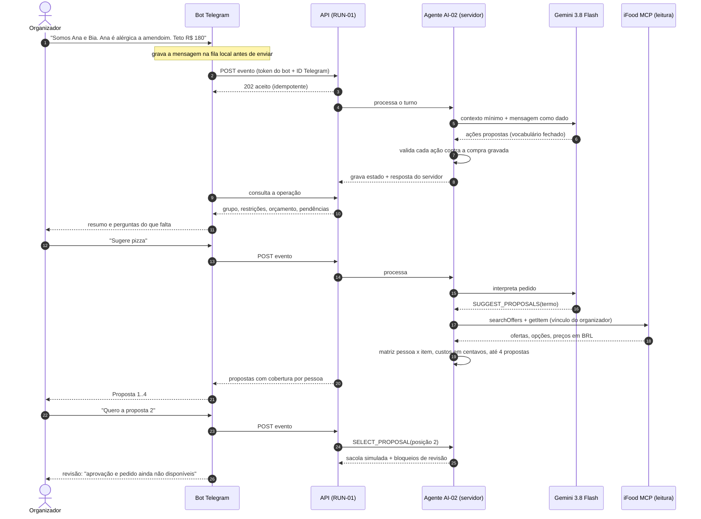
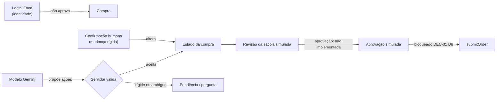
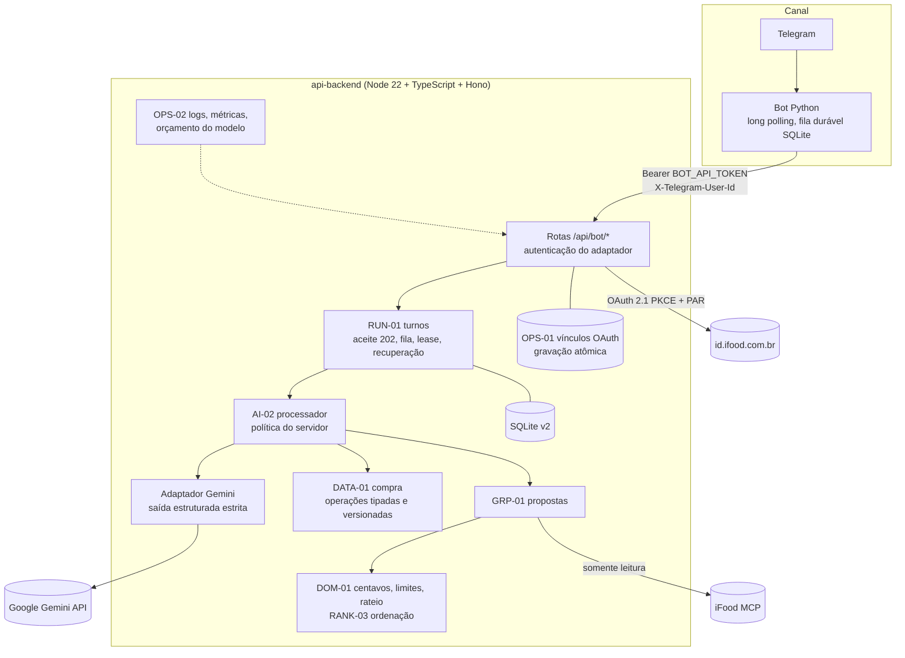

# Compra com Contexto — Entrega do Hackathon SEMCOMP × iFood 2026

**Equipe:** Modo Escuro · **Repositórios:** [api-backend](https://github.com/Modo-Escuro/api-backend) (este) e [telegram-bot](https://github.com/Modo-Escuro/telegram-bot) · **Data:** 18/10/2026 · **Base conferida:** API `main@f3b8b55`, bot `main@9314c72`

Este documento reúne os seis entregáveis obrigatórios. Ele resume e referencia os relatórios técnicos das pastas `docs/` dos dois repositórios; os detalhes ficam nos documentos de origem citados em cada seção. Links para o bot apontam para a `main` do [telegram-bot](https://github.com/Modo-Escuro/telegram-bot/tree/main/docs).

> **Leitura rápida para a banca.** O Compra com Contexto é um agente conversacional que organiza uma compra em grupo no iFood: registra quem vai comer, as alergias e dietas de cada pessoa e os limites de gasto; busca ofertas reais pelo MCP do iFood; e monta propostas mostrando, pessoa a pessoa, quem está atendido e o que não pôde ser verificado. Na demo, o MCP é usado **somente para leitura** e a sacola é **simulada**: nenhum carrinho real é criado e nenhum pedido é enviado.

**Como ler os estados citados neste documento**

| Marca | Significado |
| --- | --- |
| **Na main** | Código integrado em `main@f3b8b55`. Não implica deploy nem flag ativa. |
| **Ativado em produção** | Deploy e flags conferidos no serviço da Railway, com registro sanitizado. Não comprova que um humano usou o fluxo inteiro. |
| **Ensaiado online** | Existe registro de execução real contra o iFood ou o Telegram (com data e documento de origem). |
| **Relatado** | Etapa humana informada pelo usuário, sem inspeção independente. |
| **Avaliado com dados sintéticos** | Executado com modelo real ou fixtures reais, mas sem jornada ponta a ponta com usuário real. |
| **Em PR** | Código ou documento proposto, ainda não mergeado. |
| **Não implementado / fora da demo** | Decisão ou proposta registrada, sem código ativo. |

## Sumário

1. [Proposta de negócio](#01--proposta-de-negócio)
2. [Desenho da solução](#02--desenho-da-solução)
3. [Racional da experiência](#03--racional-da-experiência)
4. [Interface visual](#04--interface-visual)
5. [Documento técnico](#05--documento-técnico)
6. [Feedback sobre o MCP do iFood](#06--feedback-sobre-o-mcp-do-ifood)
7. [Anexo A — Matriz de cobertura da documentação](#anexo-a--matriz-de-cobertura-da-documentação)
8. [Anexo B — Capturas e informações pendentes](#anexo-b--capturas-e-informações-pendentes)
9. [Anexo C — Checklist dos seis entregáveis](#anexo-c--checklist-dos-seis-entregáveis)
10. [Anexo D — Exportação para PDF único](#anexo-d--exportação-para-pdf-único)
11. [Anexo E — Fontes utilizadas](#anexo-e--fontes-utilizadas)

---

## 01 — Proposta de negócio

### O problema da compra coletiva

Pedir comida para um grupo — uma reunião de trabalho, um evento de estudantes, uma família — parece simples, mas exige que alguém (o organizador) faça a coordenação inteira:

- descobrir **quem vai comer** e o que cada um quer;
- lembrar **quem tem alergia**, quem é vegetariano, quem não come carne de porco;
- respeitar **quanto cada pessoa pode gastar** e o teto do grupo;
- encontrar **uma loja** que atenda a todos e conferir se a soma realmente cabe;
- dividir a conta de forma justa, incluindo entrega e descontos.

Hoje essa coordenação acontece em grupos de mensagem, planilhas e memória. Os erros mais caros são silenciosos: uma alergia esquecida, uma pessoa que ficou sem opção sem ninguém perceber, um total que estoura o limite de alguém porque a taxa só apareceu no fim.

**Exemplo de conflito.** Ana é alérgica a amendoim; Bia não tem restrições; o grupo tem R$ 150. A pizzaria mais barata atende a Bia, mas o cardápio não informa se o molho de uma das opções leva amendoim. Para a Bia, a opção é ótima; para a Ana, é um risco que ninguém consegue confirmar. Em um chat de grupo, esse detalhe se perde. O produto mantém as duas pessoas separadas: a opção pode servir à Bia e ficar bloqueada para a Ana, com o motivo visível.

### Público-alvo

- **Organizador de pedidos coletivos:** quem costuma fazer o pedido do time, da república, do evento ou da família.
- **Grupos com restrições alimentares variadas**, em que errar tem consequência para a saúde de alguém.
- **Contextos com orçamento definido**, como verba de evento ou divisão entre amigos com limites diferentes.

As necessidades por papel vêm da especificação de requisitos dos stakeholders ([StRS v0.2](https://github.com/Modo-Escuro/telegram-bot/blob/main/docs/baseline/stakeholder-requirements-specification.md), ainda em validação):

| Papel | Necessidade principal (StRS) |
| --- | --- |
| Organizador da compra | Conferir cobertura do grupo, custos e mudanças antes de aprovar |
| Participante do grupo | Ter suas restrições e seu limite de gasto respeitados |
| Restaurante | Fornecer informações verificáveis de ingredientes e preparo quando solicitado |

### Proposta de valor

> O organizador descreve o grupo em uma conversa. O agente lembra de cada pessoa, busca no iFood, monta propostas que respeitam as restrições de todos e diz com clareza o que não conseguiu confirmar — sem nunca fechar a compra sozinho.

### Diferenciais

| Diferencial | O que significa na prática | Onde está |
| --- | --- | --- |
| **Cobertura por pessoa** | Cada proposta mostra, para cada participante, se está atendido, bloqueado ou "a verificar", com o motivo. Ninguém é excluído em silêncio. | [GRP-01](grp-01-propostas.md) |
| **Restrições de cada pessoa, não do grupo** | A alergia da Ana não elimina opções da Bia; cada pessoa é avaliada com as próprias restrições. | [GRP-01](grp-01-propostas.md), [DEC-01 D6](decisoes-conversacionais.md) |
| **Alergia nunca vira preferência** | Alergia é sempre obrigatória. Remover ou rebaixar algo rígido exige confirmação humana explícita. | [AI-02](ai-02-agente.md), [DEC-01 D5](decisoes-conversacionais.md) |
| **Honestidade sobre o que não se sabe** | Sem dado de alérgeno, o item fica "informação indisponível — verifique com a loja", nunca "não contém". Taxa ausente nunca vira zero. | [DEC-01 D3/D6](decisoes-conversacionais.md), [DOM-01](dom-01-centavos-limites.md) |
| **Divisão exata em centavos** | Rateio determinístico: consumo individual, itens compartilhados, entrega só entre quem consome, sobra de centavos distribuída por regra fixa. | [DEC-01 D3](decisoes-conversacionais.md), [DOM-01](dom-01-centavos-limites.md) |
| **IA que propõe, servidor que decide** | O modelo só sugere ações de um vocabulário fechado; o servidor valida tudo contra o estado gravado. | [AI-02](ai-02-agente.md) |

### Benefícios para o organizador

- **Menos trabalho de memória:** participantes, restrições e tetos ficam registrados e sobrevivem a correções ("na verdade, no máximo R$ 150").
- **Menos risco:** alergias e limites rígidos bloqueiam opções incompatíveis automaticamente.
- **Decisão mais rápida:** até 4 propostas comparáveis, ordenadas por economia ou rapidez, conforme a prioridade declarada.
- **Transparência:** o organizador vê quanto cabe a cada um e o que ainda não pôde ser confirmado antes de qualquer decisão.
- **Controle:** nada é comprado sem ação humana; na demo, nada é comprado de fato.

### Benefício para o iFood

Pedidos coletivos tendem a ter ticket maior e a ser recorrentes. Reduzir o atrito da coordenação e o risco percebido com alergias pode transformar um pedido que hoje é adiado ou dividido em vários em um pedido único. *Esta é uma hipótese de negócio; não medimos conversão nem ticket.*

### Viabilidade: o que já é executável e o que ainda é hipótese

| Dimensão | Situação | Evidência |
| --- | --- | --- |
| **Técnica — integração iFood** | Login real da conta pelo Telegram funcionou; consultas de leitura ao MCP implementadas | Ensaio online de 17/10 ([estado do bot](https://github.com/Modo-Escuro/telegram-bot/blob/main/docs/estado-atual.md)); `tools/list` autenticado em 18/10 ([INT-01](int-01-audit.md)) |
| **Técnica — IA** | Gemini interpreta o grupo em português dentro de regras fixas | 16/16 tarefas e 12/12 casos críticos com modelo real e dados sintéticos ([AI-01](ai-01-result.md)) |
| **Operacional** | Bot e API ativados na Railway com conversa e Gemini, limites de gasto definidos (US$ 0,50 de reserva, 100 chamadas por processo) | Registro de ativação de 18/10, 06:49, na [PR #15 do bot](https://github.com/Modo-Escuro/telegram-bot/pull/15) |
| **Produto — fechamento real do pedido** | Não executável com segurança hoje: faltam formato de resposta, idempotência e reconciliação nas ferramentas de carrinho | [Feedback MCP](#06--feedback-sobre-o-mcp-do-ifood), [INT-01](int-01-audit.md) |
| **Comercial** | Hipótese: menos atrito e menos risco aumentam pedidos coletivos | Não medido |

---

## 02 — Desenho da solução

### Fluxo ponta a ponta

0. **Entrar na demo.** No modo senha, o organizador envia `/entrar` com a senha da equipe; o acesso vale 24 horas e cada conta Telegram tem sua própria conversa ([acesso no bot](https://github.com/Modo-Escuro/telegram-bot/blob/main/docs/acesso-senha.md)).
1. **Conectar a conta iFood.** No Telegram, o organizador envia `/conectar`, autoriza no navegador (OAuth do iFood), volta à mensagem do login — que o bot edita para mostrar a conta mascarada e o botão **Confirmar conexão** — e confirma. `/verificar` confere se a sessão está operacional. *Ensaiado online em 17/10/2026 ([estado do bot](https://github.com/Modo-Escuro/telegram-bot/blob/main/docs/estado-atual.md)).* Com sessão operacional, o bot recupera o grupo já salvo ("Retomada informativa"), sem repetir mensagens nem mostrar propostas antigas ([BOT-02](https://github.com/Modo-Escuro/telegram-bot/blob/main/docs/bot-02-retomada-contexto.md)).
2. **Descrever o grupo.** Ex.: "Somos Ana e Bia. Ana é alérgica a amendoim. Teto de R$ 180. Preferimos o mais barato." O agente registra duas pessoas, a alergia como obrigatória, o teto do grupo e a prioridade ECONOMIA.
3. **Corrigir sem recomeçar.** "Na verdade, no máximo R$ 150." O teto muda; participantes e alergia são preservados.
4. **Perguntar só o que falta.** Se o teto for vago ("uns R$ 150") ou a prioridade não estiver clara, o agente pergunta antes de validar.
5. **Pedir sugestões.** "Sugere pizza." O servidor busca no iFood (`searchOffers`), detalha os candidatos (`getItem`), avalia cada pessoa com suas restrições e monta até 4 propostas, cada uma de uma única loja.
6. **Escolher uma proposta.** "Quero a proposta 2." A proposta vira a **sacola simulada**, com bloqueios de revisão visíveis (ex.: total desconhecido, restrição a verificar).
7. **Revisar.** O organizador vê itens, quem consome cada um, entrega, soma observada e pendências. O bot mostra "Revisão informativa.", "Custo desconhecido; revisão/aprovação indisponível." e cada pendência, incluindo *"Sacola simulada: aprovação e pedido ainda não estão disponíveis nesta etapa."*

Enquanto a API processa, o organizador pode continuar escrevendo: as mensagens entram em fila e são tratadas na ordem. `/andamento` mostra a fila, `/interromper` pede a parada e `/retomar` recupera uma entrega incerta ([BOT-01](https://github.com/Modo-Escuro/telegram-bot/blob/main/docs/bot-01-fila-duravel.md)).

**Evidências por passo.** Passo 1: ensaiado online. Passos 2 a 7: código na `main` dos dois repositórios, exercitado com Gemini real e MCP falso com fixtures reais ([AI-01 montagem](ai-01-montagem-ensaio.md#validação-com-gemini-real-18102026-segunda-rodada)) e com testes HTTP do bot contra as rotas reais da API em loopback. O serviço em produção foi ativado em 18/10 com conversa e Gemini; o usuário relatou que a retomada funcionou, mas a jornada completa com MCP real **ainda não tem ensaio humano registrado** (ver [Anexo B](#anexo-b--capturas-e-informações-pendentes)).

### Interação usuário — agente — MCP



### Organização dos participantes

- **Um organizador real** (autenticado pelo Telegram) e **participantes simulados**, sem conta própria; tudo é "declarado pelo organizador" ([DEC-01 D1/D2](decisoes-conversacionais.md)). Limite padrão de 20 participantes ([GRP-01](grp-01-propostas.md#tamanho-da-resposta)).
- Cada participante tem estados distintos para restrições e teto: **não informado**, **a confirmar**, **nenhum** ou **declarado** ([DATA-01](data-01-compra.md)).
- **Uma compra ativa, uma loja, um endereço** por organizador.
- Com o acesso por senha (opt-in), cada pessoa admitida tem seu próprio organizador, vínculo e conversa ([acesso-bot-senha](acesso-bot-senha.md)).

### Recomendações, revisão e carrinho

| Etapa | O que acontece | Estado |
| --- | --- | --- |
| Recomendação individual (`/api/evaluate`) | Busca, detalhamento, restrições tri-estado, preço composto, ordenação por economia ou rapidez | Na main ([RANK-03](rank-03-contrato-v2.md)) |
| Propostas coletivas | Até 4 planos de uma loja, cobertura por pessoa, custos e rateio em centavos, reparo de teto coletivo | Na main ([GRP-01](grp-01-propostas.md)) |
| Sacola simulada | Proposta escolhida gravada na compra; qualquer mudança no grupo marca "precisa revalidar" | Na main |
| Revisão | Lista de bloqueios: total desconhecido, entrega não informada, faixa de preço, teto a confirmar, mínimo da loja, cobertura parcial, restrição sem confirmação | Na main |
| Aprovação simulada por botão | Clique humano preso a versão e hash; exibiria "SACOLA SIMULADA APROVADA — PEDIDO NÃO ENVIADO" | **Não implementada** ([D8](decisoes-conversacionais.md); [proposta](grp-01-propostas.md#contrato-proposto-para-aprovação-simulada-buy-01--api-01--não-implementado)) |
| Carrinho real no iFood | `createCart`/`addItemToCart` com confirmação humana | **Fora da demo**; F7 legada desligada; CART-01 não está na main |
| Envio do pedido / pagamento | `submitOrder` | **Bloqueado** no gateway, nas rotas e no lint |

### Separação entre confirmação humana e envio de pedido

Três coisas diferentes, que o sistema nunca confunde:

1. **Login no iFood** — prova quem é o organizador. *Não aprova compra.*
2. **Confirmação humana de mudanças rígidas** — remover uma alergia, rebaixar um teto, encerrar a compra. O agente transforma esses pedidos em pendência; ele nunca marca a confirmação sozinho ([AI-02](ai-02-agente.md#política-do-servidor)).
3. **Aprovação da compra e envio** — na demo, a rota de aprovação responde `ACTION_UNAVAILABLE` e `submitOrder` é inacessível. Uma aprovação futura teria de estar presa à versão e ao hash da revisão atual; qualquer mudança a invalidaria ([DEC-01 D8](decisoes-conversacionais.md)).



---

## 03 — Racional da experiência

### Por que interface conversacional

A informação de um pedido coletivo chega aos poucos e fora de ordem: alguém lembra de uma alergia depois, o orçamento muda, uma pessoa desiste. Um formulário obrigaria o organizador a ter tudo pronto antes de começar. Uma conversa aceita frases como "Somos Ana e Bia, Ana é alérgica a amendoim" e "na verdade, no máximo R$ 150" e transforma cada uma em mudanças estruturadas. O Telegram foi escolhido por já ser onde grupos combinam pedidos e por permitir botões para confirmações humanas.

### Decisões de experiência no Telegram

Decisões já implementadas no bot (`main@9314c72`), com a justificativa registrada nos documentos do repositório:

| Decisão | Por quê | Fonte |
| --- | --- | --- |
| Conversa **privada**, nunca em grupo do Telegram | Alergias e limites de gasto são dados sensíveis; o organizador declara por todos | [arquitetura do bot](https://github.com/Modo-Escuro/telegram-bot/blob/main/docs/arquitetura.md), [DEC-01 D1](decisoes-conversacionais.md) |
| A mensagem de login é **editada** para mostrar a conta mascarada e o botão, em vez de criar outra mensagem | O organizador volta ao mesmo lugar depois do navegador; evita notificações repetidas | [login no bot](https://github.com/Modo-Escuro/telegram-bot/blob/main/docs/login-ifood.md) |
| Confirmação da conta por **botão**, nunca por código digitado | Evita copiar códigos e reduz erro; o clique é um ato humano rastreável | [login no bot](https://github.com/Modo-Escuro/telegram-bot/blob/main/docs/login-ifood.md) |
| Mensagens em **fila ordenada**; correção enviada durante o processamento espera a vez, sem ser descartada nem misturada | O organizador pode escrever no próprio ritmo sem quebrar o estado | [BOT-01](https://github.com/Modo-Escuro/telegram-bot/blob/main/docs/bot-01-fila-duravel.md) |
| `/andamento`, `/interromper` e `/retomar` | Dar controle e visibilidade quando a API demora ou a entrega falha | [BOT-01](https://github.com/Modo-Escuro/telegram-bot/blob/main/docs/bot-01-fila-duravel.md) |
| **Retomada** do grupo depois do login, sem repetir a mensagem anterior nem mostrar proposta antiga | Trocar ou reconectar a conta não deve fazer o organizador recomeçar, nem reaproveitar preços de outra conta | [BOT-02](https://github.com/Modo-Escuro/telegram-bot/blob/main/docs/bot-02-retomada-contexto.md) |
| Texto simples, sem formatação, dividido em partes de até 3.500 caracteres | Funciona em qualquer cliente e não quebra emojis | [BOT-01](https://github.com/Modo-Escuro/telegram-bot/blob/main/docs/bot-01-fila-duravel.md) |
| Toda resposta da conversa termina lembrando que **nenhum pedido é enviado** | Evitar que o organizador confunda sacola simulada com pedido | `conversation_view.py` do bot |
| Fala do modelo marcada como "Assistente:"; referências internas omitidas | O texto do modelo nunca vira confirmação; IDs técnicos não aparecem | `conversation_view.py` do bot |

**Em PR (bot #15, depende da API #45):** menu persistente de botões (Conectar iFood, Minha conexão, Verificar conexão, Acompanhar, Retomar conversa, Interromper, Ajuda, Sair da demo), entrada da senha sem comando, grupo apresentado uma vez como "Certo! Seu grupo ficou assim:", perguntas de rotina uma de cada vez e login concluído sem segundo clique. Motivo registrado: pedido do usuário por respostas mais amigáveis e navegação sem digitar comandos ([conversa por botões](https://github.com/Modo-Escuro/telegram-bot/blob/codex/bot-02-ensaio-operacional/docs/conversa-por-botoes.md)). Ainda requer ensaio online.

### Redução da carga de coordenação

- **Várias informações por mensagem:** todas são aplicadas de uma vez; o agente só pergunta o que falta (restrições não informadas, orçamento, prioridade) ([AI-02](ai-02-agente.md#política-do-servidor)).
- **Estado persistente:** o grupo sobrevive a reinícios e à reconexão da conta (`/verificar` retoma participantes, condições e orçamento) ([RUN-01](runtime-turnos.md), [AI-01 roteiro](ai-01-montagem-ensaio.md#roteiro-operacional-bot-02)).
- **Escolha por posição:** "quero a proposta 2", sem IDs técnicos.

### Tratamento de ambiguidades

| Situação | Comportamento |
| --- | --- |
| "uns R$ 150", "talvez R$ 100" | Teto fica **a confirmar**; o agente pergunta; o orçamento não é validado até a resposta ([D5](decisoes-conversacionais.md)) |
| Nome ambíguo ou desconhecido | Pergunta; nada é aplicado àquela pessoa; ninguém é criado por engano |
| "Sou alérgico a camarão, mas como um pouco" | Esclarece e mantém a restrição rígida |
| Prioridade não declarada | Pergunta "economia ou rapidez?" antes de ordenar ([D9](decisoes-conversacionais.md)) |
| "Sem restrições" | Só é aceito se a própria mensagem do usuário disser isso explicitamente ([AI-01, F1 corrigido](ai-01-montagem-ensaio.md#validação-com-gemini-real-18102026-segunda-rodada)) |

As perguntas são escolhidas pelo servidor a partir do campo que falta; o texto livre do modelo nunca é exibido ao usuário.

### Restrições alimentares por pessoa

- Cada pessoa é avaliada com **as próprias** restrições; nunca com a união do grupo.
- O filtro `VEGAN`/`VEGETARIAN` do iFood conta só para aquela dieta. **Nunca comprova ausência de alérgeno** ([D6](decisoes-conversacionais.md)).
- Nome ou descrição que cita o ingrediente pode **reprovar** um item; nunca o **aprova**.
- Sem evidência específica, o item fica bloqueado para aquela pessoa com "informação indisponível — verifique com a loja".
- Se ninguém da loja atende uma pessoa, isso aparece na proposta ("Sem atendimento: Ana"), em vez de ser escondido.

### Transparência financeira

- **Centavos inteiros** em todo o domínio; o BRL do iFood é convertido uma única vez e subcentavos são rejeitados ([DOM-01](dom-01-centavos-limites.md)).
- **Desconhecido não vira zero.** O catálogo não informa taxa de serviço; por isso o total aparece como desconhecido e a mensagem diz: *"Total do pedido desconhecido: a taxa de serviço só aparece no carrinho."*
- **Soma observada não é total:** a proposta mostra "Soma dos preços observados: R$ X — não é o total (sem taxa de serviço; descontos não visíveis podem mudar o valor)".
- **Faixa quando o preço é ambíguo:** em parte do catálogo não se sabe se as opções somam ao preço-base; nesses casos o preço é exibido como faixa ([pricing-audit](pricing-audit.md)).
- **Rateio exato:** cada componente fecha no centavo; ninguém fica negativo; mesma entrada, mesma saída ([D3](decisoes-conversacionais.md)).

### Controle humano

- O modelo não tem ação de aprovação, confirmação, loja, endereço, item, carrinho ou envio. Qualquer campo extra (ex.: `humanConfirmed`) invalida a proposta inteira ([AI-02](ai-02-agente.md#vocabulário-do-modelo)).
- "Pode pedir" leva só a uma explicação de que a aprovação por botão é necessária e não existe nesta etapa.
- Encerrar a compra apaga os dados e exige confirmação humana.

### Acessibilidade e feedback de erros

- **Mensagens em português simples**, geradas pelo servidor a partir de fatos gravados.
- **Erros específicos, não genéricos:** iFood indisponível ⇒ `UNAVAILABLE` (mantém a conta conectada); sessão recusada ⇒ `RECONNECT_REQUIRED` (pede reconexão); limite do modelo atingido ⇒ `LIMIT_EXCEEDED` sem perder o estado ([bot-api](bot-api.md), [OPS-02](ops-02-operacao.md)).
- **Falhas não corrompem a conversa:** timeout, cota ou resposta inválida do modelo deixam estado e versão intactos; basta reenviar ([AI-02 Falhas](ai-02-agente.md#falhas)).
- **Texto em vez de interface gráfica pesada:** funciona em qualquer cliente Telegram e com leitores de tela do sistema. *Não realizamos teste formal de acessibilidade.*

---

## 04 — Interface visual

### Interfaces reais existentes

| Interface | Onde | Uso | Estado |
| --- | --- | --- | --- |
| **Bot Telegram** (interface da demo) | [telegram-bot](https://github.com/Modo-Escuro/telegram-bot) `main@9314c72` | Entrada por senha, login com botão, conversa do grupo, propostas, revisão | Login ensaiado online (17/10); conversa ativada em produção (18/10); ensaio humano completo pendente |
| **Bot Telegram com menu de botões** | Bot PR #15 (+ API PR #45) | Mesmo fluxo, com teclado persistente e textos mais curtos | **Em PR**; não demonstrar como pronto antes do merge e deploy |
| **Página do navegador do OAuth** | Página de autorização do iFood + retorno da API | Autorizar o acesso à conta | Ensaiada online |
| **Página web de diagnóstico** | `src/web/App.tsx` da API (Vite, `:5173`) | Status de autenticação e busca de teste, para desenvolvimento | Na main; **não é interface da demo** |

Não há aplicação web para o organizador. As telas abaixo são **sequências de conversa no Telegram**.

### Sequência de telas

Nenhuma captura foi incluída neste documento. Imagens de exemplo não substituem capturas reais; cada tela está marcada como **pendente**, com instruções no [Anexo B](#anexo-b--capturas-e-informações-pendentes) e no [storyboard do vídeo](pitch-hackathon.md#storyboard-do-vídeo). Os textos entre aspas são mensagens reais, conferidas no código: servidor em `src/server/agent/render.ts` (API) e apresentação em `src/telegram_bot/conversation_view.py` e `runner.py` (bot `main`).

| # | Tela | O que aparece na versão `main` do bot | Captura |
| --- | --- | --- | --- |
| T1 | Entrada e conexão | `/start` com "Olá! Sou o bot Compra com Contexto…"; `/entrar`; `/conectar` → botão **Abrir login do iFood**; após o navegador, a mesma mensagem passa a mostrar a conta mascarada e **Confirmar conexão**; `/verificar` | **Pendente** (fluxo de login ensaiado em 17/10) |
| T2 | Conversa inicial | Mensagem do organizador: "Somos Ana e Bia. Ana é alérgica a amendoim. Bia não tem restrições. Teto do grupo de R$ 180. Preferimos o mais barato." | **Pendente** |
| T3 | Grupo, restrições e orçamento | "Grupo informado:" · "• Ana: Alergia: amendoim (obrigatória)" · "• Bia: Sem restrições alimentares" · "Orçamento: R$ 180,00." · perguntas do que falta como "Falta esclarecer: …" · "Conversa em preparação. Nenhum pedido é enviado por este bot." | **Pendente** |
| T4 | Correção | "Na verdade, o teto do grupo é no máximo R$ 150." → grupo repetido com "Orçamento: R$ 150,00." e a alergia preservada | **Pendente** |
| T5 | Sugestões | "Sugere pizza" → para cada proposta: "Proposta informativa." · "Custo desconhecido; revisão/aprovação indisponível." · "Proposta N: itens (pessoas): preço; entrega …. Soma dos preços observados: R$ X — não é o total (…)" · "Há participante sem atendimento verificado." quando houver | **Pendente** (exige conta iFood conectada; usa MCP real) |
| T6 | Revisão da sacola | "Quero a proposta 2" → "Revisão informativa." · "Pendência: Total do pedido desconhecido: a taxa de serviço só aparece no carrinho." · "Pendência: Sacola simulada: aprovação e pedido ainda não estão disponíveis nesta etapa." · "Sacola simulada: …" | **Pendente** |
| T7 | Pedido de compra | "Pode pedir" → explicação de que a aprovação humana é necessária e não existe nesta etapa; nenhum pedido criado | **Pendente** |
| T8 | Retomada após login | "Retomada informativa da organização do grupo." com o grupo salvo, sem proposta antiga | **Pendente** (relato do usuário de que funcionou) |

Na versão `main`, o orçamento aparece duas vezes (resumo do servidor com ponto decimal, "R$ 150.00 (máximo)", e linha do bot com vírgula, "R$ 150,00"). A PR #15 do bot remove essa repetição. Ao gravar, usar a versão efetivamente implantada e não misturar capturas das duas.

**Carrinho e confirmação:** não há tela de carrinho real nem de aprovação na demo. Não exibir a frase "SACOLA SIMULADA APROVADA — PEDIDO NÃO ENVIADO" como funcionalidade: ela é requisito da D8, ainda não implementado.

---

## 05 — Documento técnico

### Arquitetura resumida



### Gemini e agente

- **Modelo:** Gemini 3.8 Flash (`gemini-3.8-flash`), escolhido em 18/10/2026 após rodada curta com 16 contextos sintéticos em português sobre o contrato de ações: **16/16 tarefas, 12/12 críticas, 16/16 saídas válidas, p95 de 3,2 s**, custo estimado de US$ 0,015 ([AI-01 resultado](ai-01-result.md)). Não é comparação controlada: Groq foi reprovada na revisão textual e Claude Sonnet parou em HTTP 400 sem amostra válida.
- **Segunda rodada real:** encontrou truncamento (o raciocínio interno consumia o teto de 800 tokens) e hesitação com "Teto de R$ 180". Após ajustes: 18/18 casos isolados, 8/8 conversas encadeadas em duas rodadas, 13/13 conversas locais, E2E pelas rotas autenticadas com MCP falso aprovado duas vezes ([AI-01 montagem](ai-01-montagem-ensaio.md#validação-com-gemini-real-18102026-segunda-rodada)).
- **Auditoria adversarial:** encontrou e corrigiu um caso em que o modelo podia trocar restrição "a confirmar" por "nenhuma" (F1). Pendências não bloqueantes F2–F4, N1–N2 registradas no mesmo documento.
- **Ativação explícita:** `CONVERSATION_MODEL_ENABLED=true` + modelo + chave + limite de chamadas. Sem isso, o runtime não tem processador e responde `UNAVAILABLE`. Sem fallback, sem retry interno, sem ferramentas, telemetria do SDK desligada.
- **Limites:** timeout configurável (padrão 15 s), 2048 tokens de saída, chamadas por processo e por conversa, reserva de gasto em micro-USD, mais o orçamento por janela da OPS-02. Todos em memória: reinício zera.

### AI-02, GRP-01 e RANK-03

| Módulo | Responsabilidade | Documento |
| --- | --- | --- |
| **AI-02** | Vocabulário fechado de 15 ações; contexto mínimo por allowlist; validação incremental com `previewDomain`; perguntas e resposta geradas pelo servidor; recusa do modelo descarta todas as ações | [ai-02-agente](ai-02-agente.md) |
| **GRP-01** | Matriz pessoa × item; planos de uma loja; custos e rateio DOM-01; teto individual e coletivo (reparo guloso + busca limitada); corte em 4 preservando cobertura; sacola simulada com revalidação | [grp-01-propostas](grp-01-propostas.md) |
| **RANK-03** | Só candidatos elegíveis; ECONOMIA (custo → prazo → preferências) ou RAPIDEZ (prazo → custo → preferências); desconhecidos depois dos conhecidos; score apenas diagnóstico; contrato de avaliação 2.0 | [rank-03-contrato-v2](rank-03-contrato-v2.md), [ranking](ranking.md) |

O ranqueador de **planos** da GRP-01 ainda é provisório (`interimPlanRanker`) até a RANK-03 expor um ranqueador próprio.

### DATA-01, DOM-01 e RUN-01

| Módulo | Responsabilidade | Documento |
| --- | --- | --- |
| **DATA-01** | Compra, participantes, restrições e limites no mesmo SQLite da RUN-01 (schema v2); 13+ operações tipadas e atômicas; confirmação humana para enfraquecer algo rígido; exclusão ao encerrar e após 24 h | [data-01-compra](data-01-compra.md) |
| **DOM-01** | Conversão BRL → centavos exata; limites locais de prazo, frete, distância, nota; subtotal conhecido ≠ total completo; rateio puro com 1000 casos de propriedade | [dom-01-centavos-limites](dom-01-centavos-limites.md) |
| **RUN-01** | Aceite 202 após commit; replay idempotente por chave/hash; fila limitada com lease e heartbeat; compare-and-swap no commit; recuperação após morte do processo (ensaiada com `kill -9`) | [runtime-turnos](runtime-turnos.md) |

### OPS-02

Entrega parcial ([ops-02-operacao](ops-02-operacao.md)): logs JSON com allowlist de campos e redação de telefone, CPF, tokens e IDs; `X-Correlation-Id` aleatório por requisição; métricas em memória por padrão de rota; orçamento do modelo por conversa e global (estouro ⇒ `LIMIT_EXCEEDED` antes da chamada); `GET /api/ops/status` autenticado; liberação gradual por `CONVERSATION_ORGANIZER_IDS` com falha fechada; erro 500 com mensagem fixa; `IFOOD_SUBMIT_ENABLED` ignorado e reportado. Sem exportador Prometheus/OTel.

### Hono, TypeScript, SQLite e OAuth

- **Hono + TypeScript strict** em Node ≥ 22.13; schemas `zod` estritos nas bordas; `domain/*` é puro (sem rede), testado com fixtures reais sanitizadas.
- **SQLite nativo** (`node:sqlite`) para turnos e compra; migração apenas para frente; banco em volume persistente.
- **OAuth 2.1 com PKCE S256 e PAR** contra `id.ifood.com.br`; `redirect_uri` comparado literalmente pelo servidor de autorização; tokens por vínculo, gravados com tmp + fsync + rename; nunca em resposta, UI ou log. Falha de rede ⇒ `UNAVAILABLE`; refresh recusado ⇒ `RECONNECT_REQUIRED` ([OPS-01](ops-01-persistencia.md), [bot-api](bot-api.md)).
- **Validação atual:** em `main@f3b8b55`, Linux, Node 22.23.1: **941 testes aprovados em 56 arquivos**, typecheck e lint aprovados (execução de 18/10/2026 para esta entrega). CI do projeto roda Ubuntu/Windows × Node 22.13/24.

### Bot Telegram (telegram-bot)

Fonte: [arquitetura](https://github.com/Modo-Escuro/telegram-bot/blob/main/docs/arquitetura.md), [BOT-01](https://github.com/Modo-Escuro/telegram-bot/blob/main/docs/bot-01-fila-duravel.md), [BOT-02](https://github.com/Modo-Escuro/telegram-bot/blob/main/docs/bot-02-retomada-contexto.md), [acesso por senha](https://github.com/Modo-Escuro/telegram-bot/blob/main/docs/acesso-senha.md).

- **Python 3.12**, transporte HTTP pela biblioteca padrão, `jsonschema` para validar respostas contra o contrato v1.0 fixado por hash ([cliente de conversa](https://github.com/Modo-Escuro/telegram-bot/blob/main/docs/cliente-conversa.md)). Long polling: não expõe porta nem recebe conexões.
- **Fila durável (outbox) em SQLite:** mensagem e cursor do Telegram gravados juntos antes de qualquer chamada à API; um worker separado envia, acompanha a operação e apresenta o snapshot **atual** (nunca um resultado antigo). Replay reenvia os mesmos bytes; a API deduplica.
- **Limites:** até 10 mensagens pendentes por conversa, corpo de até 16 KiB, 5 s por chamada HTTP, até 3 tentativas automáticas (5/10/20 s) antes de exigir `/retomar`.
- **Acesso por senha:** HMAC da versão da senha (a senha não é guardada), sessão de 24 h, até 5 tentativas por conta e 100 por janela de 15 min, até 100 sessões; cada usuário tem diretório, fila e cliente próprios.
- **Privacidade:** o bot não guarda texto de resposta, snapshot, URL de login, `confirmationId` ou tokens; corpos pendentes expiram em 24 h e metadados em 7 dias (D7).
- **Testes:** 177 testes (7 HTTP contra as rotas reais da API em loopback, com Gemini e OAuth sintéticos) no registro de ativação; 185 na PR #15. Números informados nos registros da equipe; não foram reexecutados para esta entrega.

### Implantação registrada

| Data | O que foi conferido | Fonte |
| --- | --- | --- |
| 17/10/2026 | Bot online na Railway com volume `/data`; login iFood concluído pelo usuário; backend confirmou `CONNECTED`, sessão operacional e verificação `OK` | [estado atual do bot](https://github.com/Modo-Escuro/telegram-bot/blob/main/docs/estado-atual.md) |
| 18/10/2026 | `tools/list` autenticado do MCP executado pelo usuário no Console Railway; healthcheck da API com armazenamento em volume | [INT-01](int-01-audit.md) |
| 18/10/2026, 06:49 | Bot `9314c72` com conversa habilitada (1 instância de polling, sem erros no log); API `28edd06` com runtime e Gemini ativos, SQLite íntegro, F7 e sessão global desligadas; backups dos SQLite e vínculos feitos antes | [registro de ativação na PR #15 do bot](https://github.com/Modo-Escuro/telegram-bot/pull/15) |

Configuração do modelo nessa ativação: `CONVERSATION_MODEL_MAX_REQUESTS=100`, `…_PER_CONVERSATION=40`, reserva de US$ 0,50, timeout de 15 s, 2.048 tokens de saída. A `main` atual da API (`f3b8b55`) inclui commits posteriores, como a OPS-02, **sem deploy registrado**. O checklist humano do ensaio (coleta e correção com Gemini, retomada após login, isolamento entre duas contas) está **desmarcado** no registro.

### Ferramentas MCP utilizadas

| Ferramenta | Uso | Escrita? |
| --- | --- | --- |
| `listAddresses` | Endereço do organizador; também verifica se a sessão está operacional | Não |
| `searchOffers` | Busca de candidatos (`query` descritivo + `refinements`) | Não |
| `getItem` | Detalhe obrigatório antes de recomendar: opções, limites, preço, pedido mínimo | Não |
| `browseOffers`, `getRecommendations`, `getMerchant` | Alternativas e detalhe de loja, previstas no MVP | Não |
| `getUser` | Só `includeProfileData=false`, para a identidade mascarada na confirmação do vínculo | Não |
| `createCart`, `addItemToCart`, `submitOrder`, pagamento, cupons | **Não chamadas.** Bloqueadas no gateway, nas rotas e por regra de lint | — |

### Carrinho: sacola simulada × integração real (CART-01)

| | Sacola simulada (demo) | Carrinho real (CART-01) |
| --- | --- | --- |
| Onde está | Na main da API ([GRP-01](grp-01-propostas.md)); apresentada pelo bot `main` | Não está na main de nenhum repositório. Segundo as PRs [API #43](https://github.com/Modo-Escuro/api-backend/pull/43) e [bot #16](https://github.com/Modo-Escuro/telegram-bot/pull/16) (rascunhos, só documentação), a implementação existe apenas em checkout local `codex/cart-01-confirmed-writes`, não publicado |
| Chamadas ao iFood | Nenhuma escrita | Preparar carrinho (`PREPARE_CART`: `createCart`/`addItemToCart`) mediante confirmação humana específica, separada de uma futura aprovação de pedido (proposta do #43/#16, ainda não adotada) |
| Decisão | DEC-01 D8 na `main`: sacola 100% simulada, MCP só leitura | Segundo o [épico #6](https://github.com/Modo-Escuro/telegram-bot/issues/6), a equipe **aprovou** preparar carrinho real após confirmação humana específica; a DEC-01 revisada que registra isso está no #43 (rascunho). Ativação bloqueada pela INT-02 (issue #40: saídas reais e reconciliação) |
| Estado | Disponível na demo | **Em implementação**, não demonstrável: código só local; CART-01, BUY-01, BUY-02, INT-02 e BOT-03 abertas (8 de 23 tarefas abertas no épico) |
| Envio e pagamento | Inexistentes | Proibidos também na proposta do #43 |
| Código legado | — | F7 (PR #4) desligada por `IFOOD_CART_ENABLED=false`; parsers testados só com saídas sintéticas ([INT-01](int-01-audit.md)) |

### Segurança, idempotência e observabilidade

- **Autoridade no servidor:** o bot apresenta e valida a origem humana; o modelo só propõe; a API decide.
- **Isolamento por vínculo:** tokens, sessão MCP e cache por organizador; `userId` nunca enviado.
- **Entradas externas são dados:** texto do catálogo e mensagens de erro do MCP nunca viram instrução para o agente. A avaliação incluiu um caso de injeção pelo catálogo.
- **Idempotência:** evento com chave e hash; replay devolve a mesma operação; conteúdo diferente com a mesma chave é conflito; resultado remoto desconhecido bloqueia reenvio.
- **Privacidade (D7):** dados da compra apagados ao encerrar ou após 24 h; logs sem texto, nomes, alergias, endereço ou valores por pessoa.

### Principais decisões

| Decisão | Motivo |
| --- | --- |
| MCP somente leitura e sacola simulada (D8) | Sem saídas de carrinho observadas, sem chave de idempotência e sem reconciliação confiável, escrita real teria risco de pedido duplicado ou desconhecido |
| Alergia sem evidência bloqueia (D6) | O MCP não expõe alérgenos; "não informado" não pode virar "não contém" |
| Ordenação estrita por prioridade declarada (D9) | Explicável e previsível; score ponderado escondia trocas |
| Centavos inteiros (DOM-01) | Rateio exato e sem erro de ponto flutuante |
| Modelo com vocabulário fechado (AI-02) | Limita o que um erro ou injeção pode causar |
| Gemini 3.8 Flash | Único candidato que concluiu a rodada no contrato real, com latência e custo baixos |

### Limitações

- Total exato sempre desconhecido (taxa de serviço ausente) ⇒ aprovação sempre bloqueada nesta etapa.
- Alergias quase sempre "a verificar" (sem dados de alérgeno).
- Aprovação simulada por botão não implementada; ações por botão dependem de eventos `CALLBACK` ainda não aceitos pelo contrato v1.
- Metas D10 (p95 ≤ 10 s ponta a ponta com MCP real, 5 demos seguidas) **sem evidência registrada**.
- Busca de planos limitada (8 opções por pessoa, 240 combinações); não garante o ótimo, e a explicação diz isso.
- Orçamento do modelo e métricas por processo; zeram ao reiniciar.
- Último deploy registrado é o de 18/10, 06:49 (API `28edd06`); versões posteriores e o ensaio humano da conversa completa não estão registrados.
- A StRS prevê fechamento do carrinho pelo MCP no hackathon (RS27); a demo para antes disso por decisão (D8), e a banca pode esperar mais ([risco R1 da DEC-01](decisoes-conversacionais.md#riscos)).

---

## 06 — Feedback sobre o MCP do iFood

Cada item indica a **evidência**: *confirmado* (observado em resposta ou metadado real) ou *inferido* (conclusão a partir dos dados, sem confirmação do provedor). "Não encontramos" significa que não estava no universo que investigamos — não que não exista na plataforma.

| # | Problema observado | Evidência | Impacto na implementação | Solução adotada | Sugestão ao time iFood |
| --- | --- | --- | --- | --- | --- |
| F1 | **Semântica de preço ambígua.** Em 11 de 38 itens reais, `unitPrice` é exatamente a soma das opções obrigatórias mais baratas; nos demais, as opções são acréscimos. Ex.: "Promoção pizza grande" daria R$ 143 pela regra base + opções | Dado: *confirmado*. Semântica: *inferida* ([pricing-audit](pricing-audit.md)) | Não dá para afirmar preço único; orçamento pode ser violado ou subestimado | Detecção do padrão e exibição em **faixa** (R$ 65–143 no exemplo); teto só passa se a faixa inteira couber | Expor um campo explícito de modelo de preço por item (ex.: "opções somam ao preço" × "opções são acréscimo") ou uma ferramenta de cotação de item configurado, sem criar carrinho |
| F2 | **Taxa de serviço ausente no catálogo** | *Confirmado* nas respostas observadas ([DOM-01](dom-01-centavos-limites.md)) | Total completo sempre desconhecido; nenhum teto pode ser comprovado; aprovação bloqueada | `service: UNKNOWN`; "soma observada — não é o total" | Informar a taxa de serviço (ou regra de cálculo) em `getMerchant`/`getItem`, ou oferecer cotação somente leitura |
| F3 | **Sem informação de alérgenos** por item ou opção | *Confirmado*: campo inexistente nos payloads | Quase toda alergia fica "a verificar" e bloqueia itens para quem a declarou | Tri-estado; "informação indisponível — verifique com a loja"; nunca "não contém" | Campo estruturado de alérgenos/ingredientes por item e opção, distinguindo "não contém", "contém" e "não informado" |
| F4 | **Escopo do filtro `itemRestrictions` não documentado** (VEGAN, GLUTEN_FREE…) | *Inferido*: não há descrição da origem/garantia do filtro | Não sabemos se `GLUTEN_FREE` serve para celíacos | Filtro conta só para a dieta; nunca para alergia ou doença celíaca ([D6](decisoes-conversacionais.md)) | Documentar a origem (declarado pela loja? curado?) e a garantia de cada filtro |
| F5 | **Nenhuma ferramenta publica `outputSchema`** (15/15 selecionadas) | *Confirmado* em `tools/list` autenticado de 18/10 ([INT-01](int-01-audit.md)) | Parsers de carrinho só puderam ser escritos com hipóteses; F7 permanece bloqueada | Respostas em formato desconhecido bloqueiam a escrita seguinte (`RESULT_UNKNOWN`) | Publicar `outputSchema` para todas as ferramentas, principalmente as de carrinho e pedido |
| F6 | **Annotations incoerentes:** `readOnlyHint:false`, `destructiveHint:true`, `idempotentHint:false` inclusive em `getCart`, `getOrder` e `trackOrder` | *Confirmado* em `tools/list` | Hints não podem ser usados como política de segurança | Lista própria de ferramentas de leitura permitidas | Corrigir os hints; consultas devem declarar `readOnlyHint:true` |
| F7 | **Sem chave de idempotência nem consulta por intenção** em `createCart`/`submitOrder`; `getOrder`/`trackOrder` exigem `orderId` já conhecido | *Confirmado* no universo investigado; ausência na plataforma *não provada* | Timeout em criação ou envio deixaria efeito remoto desconhecido, sem forma de reconciliar | Escrita fora da demo; resultado desconhecido bloqueia reenvio | Aceitar `idempotencyKey` nas mutações e permitir listar carrinhos/pedidos recentes por chave de requisição |
| F8 | **`required` formal diverge das descrições** (`createCart.required=[]`; `options` fora do required de add/update; `userConsent` não obrigatório em submit) | *Confirmado* em `tools/list` | Risco de chamadas incompletas aceitas pelo schema | Exigências conservadoras na aplicação | Alinhar `required` ao comportamento real |
| F9 | **Pagamento contraditório:** descrições citam `PIX`/`CREDIT_CARD`, mas `paymentMethodId` exige UUID | *Confirmado* no input | Impossível montar o pagamento com segurança | Parser bloqueia; só IDs retornados pelo MCP | Corrigir a descrição ou documentar o mapeamento |
| F10 | **Formatos de erro diferentes por domínio** (`errors[]` em discovery, `error` em cart, `isError` com JSON como texto em `content`) e campo `agent_instruction` com instrução ao agente | *Confirmado* em fixtures reais ([searchOffers-error-empty-query](../fixtures/searchOffers-error-empty-query.json), [mcp-error-upstream-internal](../fixtures/mcp-error-upstream-internal.json)) | Mapeamento específico por ferramenta; instruções vindas de resposta externa precisam ser tratadas como dado | Mapeamento de `code`/`retryable`; texto externo nunca vira instrução | Envelope de erro único em `structuredContent`, com `code`, `retryable` e mensagem separada de dica ao agente |
| F11 | **Falha upstream `INTERNAL`** em `listAddresses` e `getItem` (17/10, ~23h UTC) | *Confirmado* (fixture real) | Sessão marcada indisponível durante a falha | `UNAVAILABLE` sem logout; sem retry imediato | Página de status pública ou campo de disponibilidade |
| F12 | **Documentação do portal difícil de consumir por ferramentas:** as páginas HTML salvas eram cascas de SPA sem conteúdo; a ferramenta web não abriu o portal | *Confirmado* para nosso ambiente ([pricing-audit](pricing-audit.md), [INT-01](int-01-audit.md)) | Usamos documento local transcrito, sem garantia de versão | Contrato verificado só por respostas reais e `tools/list` | Publicar a documentação também em formato estático (Markdown/`llms.txt`) e versionado |
| F13 | **Totais confirmados só existem em `getCart`**, que exige criar carrinho | *Confirmado* pela descrição das ferramentas | Para saber o preço real seria preciso escrever no iFood | Estimativas e faixas, sempre rotuladas | Ferramenta de cotação somente leitura (itens + opções + endereço → totais) |
| F14 | **Não há ferramenta para consultar o restaurante** sobre ingredientes ou preparo | *Confirmado* na lista de ferramentas capturada ([tools-list](../fixtures/tools-list.json)) | O requisito de confirmação rastreável com o restaurante (StRS RS12/RS13) não pode ser cumprido; o item continua bloqueado | Bloqueio com "verifique com a loja" ([D6](decisoes-conversacionais.md)) | Canal estruturado de pergunta ao restaurante, com resposta vinculada a loja, item e variante |

**O que funcionou bem** (*confirmado*):

- Descoberta OIDC e OAuth 2.1 com PKCE e PAR funcionaram; o login completo foi ensaiado online.
- Mensagens de erro com orientação útil para agentes (ex.: query vazia explica separar termo descritivo de `refinements`).
- `tools/list` estável: a projeção de 15 ferramentas coincidiu 15/15 entre a captura antiga e a nova consulta autenticada.
- `getUser` com `includeProfileData=false` permitiu mostrar a identidade mascarada sem expor dados pessoais.

---

## Anexo A — Matriz de cobertura da documentação

Entregáveis: **E1** negócio · **E2** desenho · **E3** experiência · **E4** interface · **E5** técnico · **E6** feedback MCP. ● fonte principal · ○ apoio.

### A.1 — Visão integrada: backend × bot × entregáveis

| Entregável | Fonte no backend | Fonte no bot | Evidência mais forte | Lacuna |
| --- | --- | --- | --- | --- |
| E1 Negócio | DEC-01, GRP-01 | StRS v0.2 (stakeholders, RN01–RN07), plano conversacional | Necessidades por papel na StRS | Valor comercial não medido; StRS em validação |
| E2 Desenho | AI-02, GRP-01, bot-api, conversa v1 | Arquitetura, BOT-01, BOT-02, login | Login ensaiado online; ativação em produção | Ensaio humano da jornada completa |
| E3 Experiência | AI-02 (política), DEC-01 D5/D6/D9 | Login (botão, edição de mensagem), BOT-01 (fila, comandos), conversa por botões (PR #15) | Decisões implementadas no código dos dois lados | Sem teste formal com usuários |
| E4 Interface | `render.ts` (textos do servidor) | `conversation_view.py`, `runner.py`, `connections.py` | Textos reais no código | **Nenhuma captura real ainda** |
| E5 Técnico | Todos os docs técnicos da API | Arquitetura, BOT-01/02, acesso por senha, Railway | 941 testes da API; 177–185 do bot; registro de ativação | Versões posteriores a `28edd06` sem deploy registrado |
| E6 Feedback MCP | pricing-audit, INT-01, DOM-01, fixtures | `baseline/contracts/*` (ferramentas capturadas), estado atual (login) | `tools/list` autenticado, fixtures reais de erro | Saídas de carrinho nunca observadas |

### A.2 — Documentos do telegram-bot (`main@9314c72`, salvo indicação)

| Documento | Finalidade | Atualização | E1 | E2 | E3 | E4 | E5 | E6 | Lacuna / observação |
| --- | --- | --- | --- | --- | --- | --- | --- | --- | --- |
| [README](https://github.com/Modo-Escuro/telegram-bot/blob/main/README.md) | Apresentação do bot | 18/10 | ○ | ○ | | | ○ | | **Desatualizado:** diz que conversa, participantes e sacola estão pendentes |
| [estado-atual](https://github.com/Modo-Escuro/telegram-bot/blob/main/docs/estado-atual.md) | Evidência online do login | 18/10 | | ● | | ○ | ● | ○ | Snapshot de 17/10; cita API "sem volume" (corrigido depois pela OPS-01) |
| [arquitetura](https://github.com/Modo-Escuro/telegram-bot/blob/main/docs/arquitetura.md) | Módulos e fronteiras | 18/10 | | ● | ○ | | ● | | Diz que o cliente de conversa "não está conectado ao runner" — superado pela BOT-01 |
| [login-ifood](https://github.com/Modo-Escuro/telegram-bot/blob/main/docs/login-ifood.md) | Passo a passo do login | 18/10 | | ● | ● | ● | ○ | | — |
| [bot-01-fila-duravel](https://github.com/Modo-Escuro/telegram-bot/blob/main/docs/bot-01-fila-duravel.md) | Texto livre, fila, comandos | 18/10 | | ● | ● | ○ | ● | | — |
| [bot-02-retomada-contexto](https://github.com/Modo-Escuro/telegram-bot/blob/main/docs/bot-02-retomada-contexto.md) | Retomada do grupo após login | 18/10 | | ● | ● | ○ | ● | | Ensaio humano pendente |
| [validacao-bot02](https://github.com/Modo-Escuro/telegram-bot/blob/main/docs/validacao-bot02.md) | Primeira etapa da BOT-02 (69 testes) | 18/10 | | | ○ | | ○ | | Histórico |
| [acesso-senha](https://github.com/Modo-Escuro/telegram-bot/blob/main/docs/acesso-senha.md) | Entrada por senha e isolamento | 18/10 | | ○ | ○ | ○ | ● | | — |
| [cliente-conversa](https://github.com/Modo-Escuro/telegram-bot/blob/main/docs/cliente-conversa.md) | Cliente v1.0 e schemas fixados | 18/10 | | | | | ● | | — |
| [contrato-conversa-proposto](https://github.com/Modo-Escuro/telegram-bot/blob/main/docs/contrato-conversa-proposto.md) | Proposta v0 | 18/10 | | ○ | | | ○ | | Histórico; v1.0 da API prevalece |
| [plano-conversacional](https://github.com/Modo-Escuro/telegram-bot/blob/main/docs/plano-conversacional.md), [backlog](https://github.com/Modo-Escuro/telegram-bot/blob/main/docs/backlog-conversacional.md), [kanban](https://github.com/Modo-Escuro/telegram-bot/blob/main/docs/kanban.md) | Plano e tarefas | 18/10 | ○ | ○ | | | ○ | | Kanban mostra 22 tarefas abertas; PR #16 propõe 15 fechadas / 8 abertas |
| [decisoes-conversacionais](https://github.com/Modo-Escuro/telegram-bot/blob/main/docs/decisoes-conversacionais.md) | Decisões abertas iniciais | 18/10 | ○ | | ○ | | | | DEC-01 da API prevalece |
| [plano-demo](https://github.com/Modo-Escuro/telegram-bot/blob/main/docs/plano-demo.md), [regras-preservadas](https://github.com/Modo-Escuro/telegram-bot/blob/main/docs/regras-preservadas.md) | Roteiro e regras herdadas | 17–18/10 | ○ | ○ | ○ | | | | Partes históricas |
| [deploy-railway](https://github.com/Modo-Escuro/telegram-bot/blob/main/docs/deploy-railway.md), [executar-bot](https://github.com/Modo-Escuro/telegram-bot/blob/main/docs/executar-bot.md) | Operação e execução local | 17–18/10 | | | | | ● | | — |
| [StRS v0.2](https://github.com/Modo-Escuro/telegram-bot/blob/main/docs/baseline/stakeholder-requirements-specification.md) | Requisitos dos stakeholders | 17/10 | ● | ○ | ● | | | ○ | Em validação; prevê fechamento do carrinho (RS27) |
| [baseline/contracts](https://github.com/Modo-Escuro/telegram-bot/tree/main/docs/baseline/contracts) | Ferramentas MCP capturadas | 17/10 | | | | | ○ | ○ | Cópias históricas |
| [evidencias/login-ifood-2026-10-17.json](https://github.com/Modo-Escuro/telegram-bot/blob/main/docs/evidencias/login-ifood-2026-10-17.json) | Evidência sanitizada do login | 17/10 | | | | | ● | | — |
| `ensaio-bot02-operacional.md`, `conversa-por-botoes.md`, `evidencias/bot02-activation-2026-10-18.json` | Ativação em produção, roteiro humano, menu de botões | 18/10 | | ● | ● | ● | ● | | **Só na PR #15** (`codex/bot-02-ensaio-operacional`), não na `main` |

### A.3 — Documentos do api-backend

| Documento | Finalidade | Atualização | E1 | E2 | E3 | E4 | E5 | E6 | Lacuna / observação |
| --- | --- | --- | --- | --- | --- | --- | --- | --- | --- |
| [decisoes-conversacionais](decisoes-conversacionais.md) (DEC-01) | Decisões D1–D10 da demo | 18/10 | ● | ● | ● | ○ | ● | ○ | PR #43 (rascunho) propõe revisar D8 para carrinho real |
| [plano-conversacional](plano-conversacional.md) | Tarefas, estado por evidência Git, gates | 18/10 | ○ | ○ | | | ● | | Auditoria referencia `dc448f9`; não cita #38/#41 já mergeados |
| [requirements](requirements.md) | Recorte histórico de recomendação (FR-1..9) | 18/10 | ○ | ○ | ○ | ○ | ○ | | Histórico; ressalvas vigentes no topo |
| [grp-01-propostas](grp-01-propostas.md) | Propostas coletivas e sacola simulada | 18/10 | ● | ● | ● | ○ | ● | ○ | Proposta de aprovação simulada não implementada |
| [ai-02-agente](ai-02-agente.md) | Vocabulário de ações e política do servidor | 18/10 | | ● | ● | | ● | | — |
| [ai-01-montagem-ensaio](ai-01-montagem-ensaio.md) | Montagem Gemini, limites, roteiro BOT-02, rodada real | 18/10 | | ○ | ○ | ○ | ● | | Roteiro BOT-02 sem resultado online registrado |
| [ai-01-result](ai-01-result.md) | Escolha do Gemini e números da rodada | 18/10 | | | | | ● | | — |
| [ai-01-evaluation](ai-01-evaluation.md), [ai-01-model-options](ai-01-model-options.md), [ai-01-text-review](ai-01-text-review.md) | Histórico da comparação de modelos | 18/10 | | | | | ○ | | Marcados como históricos |
| [runtime-turnos](runtime-turnos.md) (RUN-01) | Turnos duráveis e recuperação | 18/10 | | ○ | ○ | | ● | | — |
| [data-01-compra](data-01-compra.md) | Modelo da compra e exclusão D7 | 18/10 | | ○ | ○ | | ● | | — |
| [dom-01-centavos-limites](dom-01-centavos-limites.md) | Centavos, limites, rateio | 18/10 | ○ | | ● | | ● | ● | Fonte da ausência de taxa de serviço |
| [rank-03-contrato-v2](rank-03-contrato-v2.md), [ranking](ranking.md) | Ordenação D9 e contrato 2.0 | 18/10 | | ○ | ○ | | ● | | `ranking.md` diz "implementada localmente na branchBruna" — desatualizado (já está na main pelo #34) |
| [ops-01-persistencia](ops-01-persistencia.md) | Vínculos persistentes, backup | 18/10 | | | | | ● | | Volume efetivo exige conferência operacional |
| [ops-02-operacao](ops-02-operacao.md) | Logs, métricas, orçamento, status | 18/10 | | | ○ | | ● | | Ensaios na plataforma não executados |
| [bot-api](bot-api.md) | Contrato bot → API (login, avaliação) | 18/10 | | ● | ○ | ● | ● | | — |
| [conversation-api-v1](conversation-api-v1.md), [api-01-validation](api-01-validation.md) | Contrato de conversa v1.0 | 18/10 | | ○ | | | ● | | Aceita só eventos `TEXT` |
| [acesso-bot-senha](acesso-bot-senha.md) | Acesso por senha opt-in | 18/10 | | ○ | | | ○ | | — |
| [int-01-audit](int-01-audit.md) (+ JSON e script) | Auditoria F7 e contrato externo | 18/10 | | | | | ● | ● | Saídas de carrinho não observadas |
| [pricing-audit](pricing-audit.md) | Semântica de `additionalPrice` | 17/10 | | | ● | | ○ | ● | Semântica não confirmada pelo provedor |
| [f7-cart-checkout](f7-cart-checkout.md), [f7-validation](f7-validation.md) | Carrinho legado F7 | 18/10 | | | | | ○ | ○ | `f7-validation` descreve PR #4 "sem merge" — histórico |
| [reviews/branchBruna-8393615](reviews/branchBruna-8393615.md) | Revisão de ranking | 18/10 | | | | | ○ | | Histórico |
| [evidence/ai-01/](evidence/ai-01/) | Manifestos e relatórios das rodadas | 18/10 | | | | | ○ | | — |
| `../documenta_o_oficial_ifood_mcp.md` | Transcrição local da documentação do MCP | 17/10 | | | | | ○ | ○ | Versão externa não revalidada |
| `../CLAUDE.md` | Invariantes e regras de ouro | 18/10 | | | ○ | | ○ | | Cita "Gemini escolhido no ensaio do #35" — coerente |
| [README.md](README.md) (docs) | Índice | 18/10 | | | | | ○ | | Não lista entrega e pitch (ver README da raiz) |

**Duplicações e contradições encontradas** (não corrigidas aqui; registradas para a equipe):

1. [ranking.md](ranking.md) abre com "RANK-03 implementada localmente na branchBruna … sem commit/integração novos", mas a RANK-03 está na main pelo PR #34.
2. [f7-validation.md](f7-validation.md) diz "PR #4 em rascunho, sem merge"; o F7 foi incorporado depois (ver [docs/README](README.md)).
3. O README e a [arquitetura](https://github.com/Modo-Escuro/telegram-bot/blob/main/docs/arquitetura.md) do bot listam a conversa de compras como pendente ou desconectada; o código está na `main` do bot (PRs #10/#11) e foi ativado em produção em 18/10. O ensaio humano completo não está registrado.
4. [plano-conversacional.md](plano-conversacional.md) lista `feat/ops-02` e `codex/run-01-finalizacao` como não integradas; ambas foram mergeadas depois (#38, #41).
5. Texto de configuração de tokens do Gemini: 800 tokens em [ai-01-result](ai-01-result.md) (rodada #35) e 2048 em [ai-01-montagem-ensaio](ai-01-montagem-ensaio.md) (valor vigente). Ambos estão corretos para seu momento.
6. O [estado atual do bot](https://github.com/Modo-Escuro/telegram-bot/blob/main/docs/estado-atual.md) diz que a API está "sem volume"; a [INT-01](int-01-audit.md) e o registro de ativação de 18/10 mostram armazenamento em volume.
7. O registro de ativação (PR #15 do bot) e a `main` da API divergem: produção em `28edd06`, `main` em `f3b8b55`.

---

## Anexo B — Capturas e informações pendentes

### Capturas de tela

Todas as capturas da conversa vêm do **bot Telegram em produção** (telegram-bot). Usar **somente dados sintéticos** (nomes Ana/Bia, nenhuma pessoa real) e borrar e-mail, telefone, endereço e a conta mascarada. Não montar imagens: se a captura não puder ser feita, deixar o espaço marcado como pendente.

**Qual versão gravar.** Conferir o commit implantado do bot e da API antes de gravar e anotar na legenda. Se as PRs bot #15 e API #45 forem mergeadas e implantadas antes da gravação, gravar a versão com menu de botões; caso contrário, gravar a `main` atual (comandos com barra). Não misturar as duas versões no mesmo vídeo ou conjunto de capturas.

| # | Captura | Origem | Pré-requisito | Como obter |
| --- | --- | --- | --- | --- |
| C1 (T1) | Entrada e login: `/entrar` → `/conectar` → navegador → mensagem editada com conta mascarada → **Confirmar conexão** → `/verificar` | Bot + página do iFood | Conta iFood **de teste** do evento; não desconectar uma conta só para gravar | Executar o fluxo; capturar 3 mensagens do bot e a página de retorno |
| C2–C4 (T2–T4) | Conversa inicial, grupo e correção | Bot | Conversa ativa (já ativada em 18/10) | Enviar as frases do roteiro abaixo, aguardando cada resposta |
| C5 (T5) | Propostas | Bot (leitura **real** do MCP) | Vínculo operacional | Enviar "Sugere pizza" |
| C6 (T6) | Revisão da sacola simulada | Bot | C5 concluída | Enviar "Quero a proposta 2" |
| C7 (T7) | "Pode pedir" | Bot | C6 concluída | Enviar "Pode pedir" e capturar a explicação |
| C8 (T8) | Retomada após login | Bot | Grupo salvo | `/verificar` com sessão operacional |
| C9 | `GET /api/ops/status` mostrando `purchase.capable: false` e `submission: DISABLED` | API | Deploy que inclua a OPS-02 (não registrado ainda) | Chamada autenticada; recortar só o bloco `purchase` |

Frases do roteiro (do [ensaio operacional do bot](https://github.com/Modo-Escuro/telegram-bot/pull/15)): "Somos Ana e Bia. Ana é alérgica a amendoim. Bia não tem restrições. Teto do grupo de R$ 180. Preferimos o mais barato." → "Na verdade, o teto do grupo é no máximo R$ 150." → "Sugere pizza" → "Quero a proposta 2" → "Pode pedir".

**Plano B de capturas (3 a 5):** C3 (grupo com alergia e orçamento), C4 (correção preservando a alergia), C5 (proposta com "não é o total"), C6 (revisão com pendências e "nenhum pedido é enviado") e, se houver espaço, C1 (botão de confirmação da conta). Ver também o [storyboard do vídeo](pitch-hackathon.md#storyboard-do-vídeo).

### Informações pendentes

- [ ] Versões efetivamente implantadas da API e do bot (commit) e flags ativas no dia da apresentação (último registro: bot `9314c72`, API `28edd06`).
- [ ] Ensaio humano ponta a ponta Telegram → API → Gemini → MCP real, registrado de forma sanitizada (o checklist do ensaio operacional está desmarcado).
- [ ] Gravação do vídeo da demonstração (60–85 s) e das capturas do plano B.
- [ ] Nomes dos integrantes e distribuição de falas no pitch.

**Pendências que dependem de PRs não mergeados**

| PR | Efeito na apresentação se mergeado e implantado | Enquanto aberto |
| --- | --- | --- |
| [bot #15](https://github.com/Modo-Escuro/telegram-bot/pull/15) | Menu de botões, textos mais curtos, registro de ativação na `main` do bot | Gravar com comandos; citar o registro de ativação como "na PR #15" |
| [API #45](https://github.com/Modo-Escuro/api-backend/pull/45) | Login sem segundo clique no Telegram | O passo de login inclui o botão **Confirmar conexão** |
| [API #43](https://github.com/Modo-Escuro/api-backend/pull/43), [bot #16](https://github.com/Modo-Escuro/telegram-bot/pull/16) | Revisão da DEC-01 para preparar carrinho real com confirmação humana | Apresentar só a sacola simulada (D8) |
| [API #29](https://github.com/Modo-Escuro/api-backend/pull/29) | Nenhum (substituído pelo #30, já mergeado) | Sem impacto |

- [ ] Metas D10: p95 ponta a ponta e 5 demos seguidas — medir ou declarar como não medidas.

---

## Anexo C — Checklist dos seis entregáveis

| # | Entregável | Seção | Situação |
| --- | --- | --- | --- |
| 1 | Proposta de negócio | [01](#01--proposta-de-negócio) | Completo |
| 2 | Desenho da solução | [02](#02--desenho-da-solução) | Completo (2 diagramas) |
| 3 | Racional da experiência | [03](#03--racional-da-experiência) | Completo |
| 4 | Interface visual | [04](#04--interface-visual) | **Estrutura completa; capturas pendentes** ([Anexo B](#anexo-b--capturas-e-informações-pendentes)) |
| 5 | Documento técnico | [05](#05--documento-técnico) | Completo (1 diagrama) |
| 6 | Feedback sobre o MCP | [06](#06--feedback-sobre-o-mcp-do-ifood) | Completo (14 itens com evidência) |

---

## Anexo D — Exportação para PDF único

Os diagramas usam Mermaid; o GitHub os renderiza automaticamente. Para gerar um PDF:

**Opção 1 — navegador (mais simples).** Abrir este arquivo no GitHub, aguardar os diagramas renderizarem e usar *Imprimir → Salvar como PDF* (margens padrão, "Gráficos de fundo" ligado).

**Opção 2 — VS Code.** Extensão *Markdown PDF* (yzane.markdown-pdf), que renderiza Mermaid; comando *Markdown PDF: Export (pdf)*.

**Opção 3 — linha de comando** (requer Node; ferramentas externas ao projeto, não instaladas no repositório):

```bash
npx -y @mermaid-js/mermaid-cli -i docs/entrega-hackathon.md -o /tmp/entrega-render.md   # converte diagramas em SVG
npx -y md-to-pdf /tmp/entrega-render.md                                                  # gera /tmp/entrega-render.pdf
```

Para um PDF único com o pitch, concatenar antes: `cat docs/entrega-hackathon.md docs/pitch-hackathon.md > /tmp/entrega-completa.md`. Inserir as capturas do Anexo B como imagens antes de exportar. Conferir no PDF que os links relativos aparecem como texto legível.

---

## Anexo E — Fontes utilizadas

- **Repositório:** `Modo-Escuro/api-backend@f3b8b55` — [CLAUDE.md](../CLAUDE.md), [package.json](../package.json), [.env.example](../.env.example), `src/server/**` (rotas em `app.ts`, `routes/*.ts`; mensagens em `agent/render.ts`; rota de aprovação em `routes/conversation.ts`), `fixtures/*`.
- **Documentos:** todos os listados no [Anexo A](#anexo-a--matriz-de-cobertura-da-documentação).
- **Bot (`telegram-bot@9314c72`):** README, `AGENTS.md`, toda a pasta `docs/` (inclusive baseline StRS e evidências) e, no código, `runner.py`, `connections.py`, `conversation_view.py`, `menu.py` (PR #15).
- **Branches não mergeadas do bot lidas:** `codex/bot-02-ensaio-operacional` (PR #15: ativação, ensaio, menu de botões) e `codex/revisao-escopo-cart01` (PR #16).
- **PRs da API:** #25 (DEC-01), #26 (OPS-01), #27 (RUN-01), #30/#34 (ranking), #31 (DOM-01), #32 (DATA-01), #33 (AI-02), #35/#36 (AI-01), #37 (GRP-01), #38 (OPS-02), #39 (senha), #41 (RUN-01 testes), #42/#44 (docs) — mergeados; #43, #45, #29 — abertos. **PRs do bot:** #10/#11/#13/#14 mergeados; #15 e #16 abertos.
- **Verificação própria desta entrega:** `npm test` (941/941), `npm run typecheck`, `npm run lint` na API em `f3b8b55`, Linux, Node 22.23.1, 18/10/2026. A suíte do bot não foi reexecutada; os números citados vêm dos registros da equipe. Nenhuma chamada ao iFood, ao Gemini ou ao Telegram foi feita para esta entrega.
