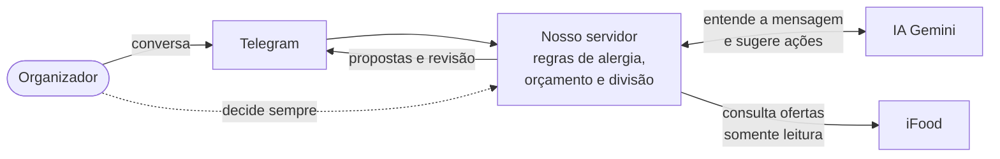

# Pitch — Compra com Contexto

Roteiro falado para o Hackathon SEMCOMP × iFood 2026. A banca do pitch avalia **produto e viabilidade**; o detalhe técnico está em [entrega-hackathon.md](entrega-hackathon.md).

## Regras de tempo

| Item | Valor |
| --- | --- |
| Limite do pitch | **5:00**: o microfone é cortado ao exceder |
| Alvo de encerramento | **4:30**, nunca depois de **4:40** |
| Perguntas da banca | 3:00 seguintes |
| Ritmo de fala | ~130 palavras por minuto; cada bloco abaixo traz a contagem de palavras |
| Vídeo | 80 s gravados (máximo 85 s), sem depender de internet ou execução ao vivo |

**Corte aos 4:15:** se o slide 5 ainda não tiver terminado, pular direto para a frase final do slide 6.

**Regra de honestidade:** o vídeo mostra a composição revisada como **sacola simulada**. A decisão do projeto é preparar o carrinho real só depois de uma confirmação humana, mas esse código está em revisão (PR #46) e não está no ar. Não dizer que o pedido foi feito, que o carrinho foi criado no iFood ou que a confirmação de carrinho já funciona.

## Distribuição de falas

A equipe preenche os nomes. Com menos pessoas, uma assume mais de um papel.

| Papel | Blocos | Responsável |
| --- | --- | --- |
| **A — Produto** | Slides 1, 2 e 6 | _a definir_ |
| **B — Demo** | Slide 3 (inicia o vídeo e narra) | _a definir_ |
| **C — Viabilidade** | Slides 4 e 5 | _a definir_ |

## Slides (6) e cronograma

| # | Tempo | Slide | Objetivo | Texto de tela | Orientação visual |
| --- | --- | --- | --- | --- | --- |
| 1 | 0:00–0:40 | **O problema** | Fazer a banca sentir o conflito | "Quem tem alergia mesmo?" · "Meu limite é R$ 40" · "Alguém fecha aí?" | Três balões de chat (ilustração, identificada como tal) e, ao lado, Ana 🥜⚠️ e Bia ✅ com a mesma pizza |
| 2 | 0:40–1:15 | **A solução** | Mostrar o produto em uma frase | **Problema → Solução → Benefício**: coordenação manual → Ailo, assistente no Telegram que lembra de cada pessoa → ninguém esquecido, conta clara, humano no controle | Três colunas com ícones; nada de arquitetura |
| 3 | 1:15–2:40 | **Demo** | Provar a experiência | Selo fixo: "Gravação real · dados fictícios · nenhum pedido enviado" | Vídeo de 80 s com legendas (ver storyboard) |
| 4 | 2:40–3:40 | **É viável hoje** | Provar viabilidade com evidências | "Login real no iFood" · "IA testada: 16/16" · "No ar desde 18/10" | Diagrama de 4 caixas: Telegram → Nosso servidor (regras) → Gemini (entende) / iFood (ofertas, só leitura) |
| 5 | 3:40–4:20 | **Por que é diferente** | Diferenciais e benefícios | "Cada pessoa avaliada" · "Desconhecido não vira zero" · "Nada é comprado sem você" | Três cartões grandes |
| 6 | 4:20–4:30 | **Encerramento** | Frase memorável | "Compra com Contexto: o grupo inteiro atendido, ninguém esquecido." | Logo, QR para o repositório |

### Visual do slide 4 — solução simplificada

Exportar como imagem (ver [Anexo D da entrega](entrega-hackathon.md#anexo-d--exportação-para-pdf-único)). Sem nomes de módulos.

## Roteiro integral

### Slide 1 — O problema (0:00–0:40) · Apresentador A · ~80 palavras

> Pensa no último pedido de comida que você organizou para um grupo.
> Você abre o chat: quem vai comer? A Ana tinha alergia a quê mesmo? O limite da Bia era quarenta ou cinquenta?
> Agora: a pizzaria mais barata serve para a Bia. Mas ninguém sabe se o molho leva amendoim, e a Ana é alérgica.
> No chat, esse detalhe se perde. E o erro custa caro: a saúde de alguém, ou alguém sem comer sem ninguém perceber.

**Transição:** "Por isso criamos o Compra com Contexto."

### Slide 2 — A solução (0:40–1:15) · Apresentador A · ~70 palavras

> O Compra com Contexto traz o Ailo, um assistente no Telegram que organiza a compra do grupo no iFood.
> Você conversa normalmente: quem vai comer, as alergias, quanto dá para gastar. Ele lembra de cada pessoa, busca ofertas reais e monta propostas mostrando quem está atendido e quem não está.
> E quando falta informação, ele avisa em vez de arriscar.
> No fim, a decisão é sempre sua.

**Transição:** "Vou mostrar funcionando." *(A passa para B, que inicia o vídeo.)*

### Slide 3 — Demonstração em vídeo (1:15–2:40) · Apresentador B

Fala de abertura (1:15–1:18, ~7 palavras, enquanto o vídeo começa):

> Gravação real do Ailo, com dados fictícios.

Durante o vídeo, B narra por cima, em voz calma, seguindo as legendas. Fala de ~110 palavras distribuída nas cenas do [storyboard](#storyboard-do-vídeo):

> Uma frase só: duas pessoas, a alergia da Ana e o orçamento do grupo.
> Ele entendeu e organizou tudo. A alergia aparece como obrigatória.
> Mudou o orçamento? É só dizer. Repare: a alergia continua lá.
> Agora peço sugestões. Ele busca no iFood e monta as propostas. Para cada uma mostra quem é atendido, e avisa que a soma não é o total, porque a taxa de serviço só aparece no carrinho.
> Escolho a proposta 2. Ela vira uma sacola de revisão com as pendências visíveis.
> E nenhum pedido é enviado. Quem decide é sempre uma pessoa.

*(B passa para C ao fim do vídeo, sem fala de transição; C abre o slide 4.)*

### Slide 4 — Viabilidade (2:40–3:40) · Apresentador C · ~120 palavras

> E isso já roda hoje. São três provas.
> Primeira: o login real com a conta iFood funcionou pelo Telegram, com a pessoa confirmando a conta num botão.
> Segunda: testamos a inteligência artificial, o Gemini, com o modelo de verdade. Em dezesseis situações de teste, incluindo doze críticas, como alergia, valor ambíguo e tentativa de manipulação, ele acertou todas.
> Terceira: o bot e o nosso servidor estão no ar desde ontem de manhã, com a IA ligada e limite de gasto.
> Como funciona: o Telegram conversa com o nosso servidor. O Gemini só entende a mensagem e sugere o que fazer; quem decide são as regras do servidor. E o iFood é consultado só para leitura: a gente nunca compra sozinho.

*Ajustar "desde ontem de manhã" conforme o dia da apresentação: a ativação é de 18/10/2026, 06:49.*

### Slide 5 — Diferenciais e benefícios (3:40–4:20) · Apresentador C · ~75 palavras

> Três coisas nos diferenciam.
> Cada pessoa é avaliada com as próprias restrições: a alergia da Ana não elimina as opções da Bia, e ninguém é excluído em silêncio.
> O que a gente não sabe, a gente diz: alergia sem informação fica "a verificar", e taxa desconhecida nunca vira zero.
> E nada vai para o carrinho do iFood sem você confirmar; o pedido, nunca sozinho.
> Para quem organiza, é menos coisa para lembrar, menos risco e menos tempo no chat.

**Transição:** C devolve para A.

### Slide 6 — Encerramento (4:20–4:30) · Apresentador A · ~15 palavras

> Compra com Contexto: o grupo inteiro atendido, ninguém esquecido e você no controle. Obrigado!

**Parar de falar.** Encerramento esperado: **4:30**.

### Estimativa de duração

| Bloco | Palavras faladas (medidas) | Tempo estimado (130 ppm) | Janela |
| --- | --- | --- | --- |
| Slide 1 + transição | 85 | 0:39 | 0:40 |
| Slide 2 + transição | 70 | 0:32 | 0:35 |
| Slide 3 | 7 de abertura (falados sobre o início do vídeo) + **vídeo integral de 80 s** | 1:23 | 1:25 |
| Slide 4 (inclui a transição "E isso já roda hoje") | 120 | 0:55 | 1:00 |
| Slide 5 | 79 | 0:36 | 0:40 |
| Slide 6 | 14 | 0:06 | 0:10 |
| Trocas de apresentador e de slide (A→B, B→C, C→A, ~2 s cada) | — | 0:06 | — |
| **Total** | | **~4:19** | **4:30** |

O total de **~4:19 já inclui os 80 s inteiros do vídeo, as falas de transição e as trocas de apresentador**. A folga de ~11 s até 4:30 (e ~21 s até 4:40) cobre pausas naturais. A narração do vídeo (~97 palavras em 80 s ≈ 73 ppm) é falada por cima das cenas e não soma tempo. Se o vídeo final passar de 80 s, cortar o mesmo tempo da cena 4 (espera) ou da cena 1. Se o ensaio passar de 4:35, cortar nesta ordem: (1) a frase "E quando falta informação…" do slide 2; (2) a última frase do slide 5; (3) a frase "Como funciona…" do slide 4, mantendo só as três provas.

## Storyboard do vídeo

**Duração:** exatamente 80 s. **Formato:** gravação de tela do Telegram (celular ou Telegram Desktop), 1080p, legendas grandes na parte inferior, sem música alta. **Dados:** participantes fictícios (Ana e Bia); conta iFood **de teste** do evento; leitura **real** do iFood na cena 4. **Versão:** Ailo (bot `d239edd` ou posterior, API com o #45). Se o serviço ainda estiver em bot `9314c72`/API `28edd06`, os textos mudam (ver nota abaixo da tabela) e o login inclui o botão **Confirmar conexão**.

Antes de gravar: conta já conectada (o login completo fica nas capturas C1, não no vídeo), conversa sem grupo salvo e notificações desligadas. Gravar cada cena separadamente e montar depois.

| Cena | Tempo | Ação | Texto que deve aparecer (código atual) | Legenda | Captura |
| --- | --- | --- | --- | --- | --- |
| 0 | 0:00–0:04 | Cartão de abertura | — | "Gravação real · dados fictícios · nenhum pedido é enviado" | — |
| 1 | 0:04–0:10 | Tocar **Minha conexão** | "Pronto, sua conta iFood está conectada!" (conta borrada) | "Conta iFood de teste conectada pelo login oficial" | C1 |
| 2 | 0:10–0:28 | Enviar: "Somos Ana e Bia. Ana é alérgica a amendoim. Bia não tem restrições. Teto do grupo de R$ 180. Preferimos o mais barato." | Indicador "digitando…" → "Certo! Seu grupo ficou assim:" · "• Ana: Alergia: amendoim (obrigatória)" · "• Bia: Sem restrições alimentares" · "Orçamento do grupo: R$ 180,00 (máximo)." | "Uma mensagem: pessoas, alergia, orçamento e prioridade" | C2, C3 |
| 3 | 0:28–0:40 | Enviar: "Na verdade, o teto do grupo é no máximo R$ 150." | Grupo com "Orçamento do grupo: R$ 150,00 (máximo)." e a alergia mantida | "Correção sem recomeçar; a alergia continua" | C4 |
| 4 | 0:40–1:02 | Enviar: "Sugere pizza" (cortar a espera) | "Proposta informativa." · "Custo desconhecido; revisão/aprovação indisponível." · "Proposta 1: … Soma dos preços observados: R$ … — não é o total (…)" · "Sacola simulada. Nenhum pedido é enviado pelo Ailo." | "Ofertas reais do iFood · quem é atendido · o total real só aparece no carrinho" + selo "espera cortada" | C5 |
| 5 | 1:02–1:16 | Enviar: "Quero a proposta 2" | "Revisão informativa." · "Pendência: Total do pedido desconhecido: a taxa de serviço só aparece no carrinho." · "Pendência: Sacola simulada: aprovação e pedido ainda não estão disponíveis nesta etapa." | "Revisão com tudo que falta confirmar" | C6 |
| 6 | 1:16–1:20 | Cartão final | — | "Nenhum pedido é enviado. Quem decide é sempre uma pessoa." | — |

**Versão anterior (`9314c72`):** a resposta da cena 2 começa com "Grupo informado:", o orçamento aparece duas vezes ("R$ 180.00 (máximo)" e "Orçamento: R$ 180,00.") e as respostas terminam com "Conversa em preparação. Nenhum pedido é enviado por este bot."; não há menu nem indicador "digitando".

**Regras de edição:**
- Sinalizar cortes de espera com "espera cortada"; não acelerar nem editar o texto das mensagens.
- Borrar conta, e-mail, telefone e endereço.
- "Pode pedir" (C7) e a retomada após login (C8) ficam fora do vídeo; usar no Q&A.
- Não gravar voz: a função está desligada por padrão e não foi testada com áudio real.
- Se a cena 4 não trouxer propostas (iFood indisponível ou nenhuma loja compatível), **não simular**: gravar a resposta real e trocar a legenda para "o Ailo avisa quando não encontra opção segura", ou remover a cena e reduzir o vídeo.
- Se alguma cena não funcionar no dia, remover a cena e ajustar o tempo, nunca montar uma tela.

**Capturas para o plano B (3 a 5),** tiradas da mesma sessão: C3 (grupo), C4 (correção), C5 (proposta), C6 (revisão) e, opcionalmente, C1 (conta conectada). Detalhes no [Anexo B da entrega](entrega-hackathon.md#anexo-b--capturas-e-informações-pendentes); checklist do ensaio no [Anexo F](entrega-hackathon.md#anexo-f--checklist-operacional-do-ensaio-humano).

## Evidências de viabilidade selecionadas

No máximo três no pitch. Cada uma com o que **prova** e o que **não prova**, para responder sem exagero.

| # | Evidência | O que prova | O que não prova | Fonte |
| --- | --- | --- | --- | --- |
| 1 | Login real com a conta iFood pelo Telegram, confirmado por botão (17/10/2026) | A integração de identidade com o iFood funciona de ponta a ponta | Busca, sacola ou compra | [estado atual do bot](https://github.com/Modo-Escuro/telegram-bot/blob/main/docs/estado-atual.md) |
| 2 | Gemini real: 16/16 tarefas, 12/12 críticas, respostas sempre no formato exigido; p95 de 3,2 s; ~US$ 0,015 na rodada | O modelo entende o grupo em português dentro das regras | Comportamento com usuários reais; é amostra pequena com dados fictícios | [AI-01](ai-01-result.md) |
| 3 | Bot e API ativados na nuvem em 18/10, 06:49, com IA ligada e limites de gasto | O serviço roda fora da máquina da equipe | Que a jornada inteira foi ensaiada por um humano (checklist pendente) | [registro de ativação do bot](https://github.com/Modo-Escuro/telegram-bot/blob/main/docs/ensaio-bot02-operacional.md) |

**Se o vídeo for gravado no serviço em produção com o MCP real,** ele próprio passa a ser a evidência mais forte. Nesse caso, o slide 4 pode dizer: "o vídeo que vocês viram é o serviço no ar, com ofertas reais do iFood".

**Não usar no pitch:** número de testes (técnico demais para esta banca; guardar para o Q&A), estimativas de conversão ou ticket (não medidas), qualquer tempo de resposta ponta a ponta (não medido).

## Versão emergencial de 3 minutos

Usar se o tempo for reduzido. Encerrar em **2:50**. O vídeo é cortado para 45 s (cenas 0, 2, 4 e 5).

| Tempo | Slide | Fala |
| --- | --- | --- |
| 0:00–0:25 | 1 | "Organizar comida para um grupo é lembrar quem vai comer, quem tem alergia e quanto cada um pode gastar. Uma alergia esquecida ou alguém sem opção são erros que ninguém percebe no chat." |
| 0:25–0:45 | 2 | "O Compra com Contexto é um assistente no Telegram que lembra de cada pessoa, busca ofertas reais no iFood e mostra quem está atendido. O que ele não sabe, ele avisa." |
| 0:45–1:35 | 3 | Vídeo de 45 s. Fala: "Uma frase registra o grupo; ele busca no iFood e monta uma sacola para revisão. Nenhum pedido é enviado." |
| 1:35–2:25 | 4 | "É viável hoje: o login real com o iFood funcionou, o Gemini acertou 16 de 16 testes, incluindo os críticos, e o serviço está no ar. A IA só sugere; as regras do servidor decidem; o iFood é só consultado." |
| 2:25–2:50 | 6 | "Compra com Contexto: o grupo inteiro atendido, ninguém esquecido e você no controle. Obrigado!" |

## Plano B se o vídeo falhar

O vídeo é o plano principal (arquivo local, sem internet). Não fazer demonstração ao vivo.

| Falha | Ação imediata (≤ 5 s) | Fala de ponte |
| --- | --- | --- |
| Vídeo não abre ou trava | Avançar para o slide reserva com as 3–5 capturas (C3, C4, C5, C6, C1) | "Vou mostrar as telas do mesmo fluxo." |
| Projetor sem som | Seguir com a narração ao vivo sobre o vídeo mudo | — (a narração já é feita pelo apresentador) |
| Nenhuma mídia funciona | Narrar o storyboard apontando para o diagrama do slide 4 | Usar as legendas das cenas 2 a 5 como fala |

**Fala sobre as capturas (40–60 s):**

> Aqui o organizador descreveu o grupo numa mensagem: a Ana aparece com alergia obrigatória, a Bia sem restrições, e o orçamento do grupo.
> Aqui ele corrigiu o orçamento, e a alergia continuou registrada.
> Aqui estão as propostas com ofertas do iFood: para cada uma, quem é atendido, e o aviso de que a soma não é o total.
> E aqui a revisão da sacola, com as pendências e o lembrete de que nenhum pedido é enviado.

**Preparação obrigatória:** vídeo no notebook da apresentação e em um pendrive; slide reserva com as capturas logo após o slide 3 (oculto, acessível com uma tecla); notificações silenciadas. **Nunca** mostrar tela montada como se fosse real, nem narrar aprovação ou pedido como funcionalidade.

## Perguntas prováveis da banca (3 min)

Respostas de 20 a 40 s (≈ 45–90 palavras). Responder a pergunta primeiro, depois o detalhe.

**1. Por que vocês não fecham o pedido no iFood? (A)**
> Decidimos ir até o carrinho real, mas só depois de uma confirmação específica do organizador, e nunca enviar o pedido sozinhos. O motivo: as ferramentas de carrinho do iFood ainda não informam o formato da resposta nem têm proteção contra pedido duplicado; se a conexão cair, ninguém sabe se algo foi feito. Essa preparação com confirmação está em revisão no código. O que vocês viram no vídeo para na revisão, sem escrever no iFood.

**2. Quem pagaria por isso? Qual é o modelo de negócio? (A)**
> A gente vê isso como uma funcionalidade do próprio iFood, não como app separado: pedidos de grupo tendem a ter valor maior, e reduzir a coordenação pode transformar vários pedidos individuais, ou um pedido adiado, num pedido só. É uma hipótese: não medimos conversão. O próximo passo seria testar com grupos reais.

**3. Se o iFood não informa alérgenos, o produto não fica inútil para quem tem alergia? (A)**
> Fica limitado, e somos transparentes sobre isso. O sistema diz "informação indisponível, verifique com a loja" e não recomenda aquele item para quem tem a alergia. Isso protege a pessoa. Uma das nossas sugestões ao iFood é um campo de alérgenos: com ele, o mesmo sistema passa a liberar itens com segurança.

**4. Como garantem que a IA não ignora uma alergia? (C)**
> A IA não decide nada. Ela só sugere ações de uma lista fechada, como "registrar alergia" ou "mudar orçamento", e o servidor confere cada uma contra as regras. Alergia é sempre obrigatória, e remover uma restrição exige confirmação de uma pessoa. Testamos casos de manipulação, inclusive texto malicioso vindo do cardápio. Numa auditoria achamos um caso em que a IA podia liberar alguém sem confirmação, e corrigimos.

**5. Isso funciona de verdade ou é protótipo? (C)**
> O login real com o iFood funcionou pelo Telegram, e o bot e o servidor estão no ar com a IA ligada. A conversa foi testada com o Gemini real em situações fictícias. O ensaio completo por uma pessoa, do início até a revisão, é o que estamos registrando agora *[atualizar se o ensaio for concluído antes do pitch]*. A preparação do carrinho real ainda está em revisão. Não é um produto em produção para o público.

**6. Por que o Gemini? Quanto custa? (C)**
> Testamos no nosso caso: o Gemini 3.8 Flash acertou 16 de 16 situações, incluindo as 12 críticas, com resposta em cerca de 3 segundos. A rodada inteira custou cerca de um centavo e meio de dólar, pela tabela do Google. Além disso, há limite de chamadas e de gasto: se estourar, o sistema para antes de chamar a IA, sem perder nada.

**7. Por que Telegram e não o app do iFood? (A)**
> Porque é onde grupos já combinam pedidos, e nos permitiu entregar uma conversa com botões de confirmação durante o hackathon. Toda a inteligência está no servidor, separada da interface. A mesma lógica poderia ser usada dentro do app do iFood.

**8. Como fica a divisão da conta? (A ou C)**
> Tudo em centavos inteiros. Item individual vai para quem consome; item compartilhado é dividido igualmente; a entrega é dividida só entre quem consome. Os centavos que sobram seguem uma regra fixa, então a soma fecha exatamente: testamos com mil casos aleatórios. E se a taxa for desconhecida, o total aparece como desconhecido, não como zero.

**9. E a privacidade dos dados do grupo? (C)**
> O acesso à conta iFood fica só no nosso servidor: nunca vai para o bot, para a IA ou para os registros. Os registros não guardam nomes, alergias ou endereço. Os dados da compra são apagados ao encerrar ou depois de 24 horas sem uso.

**10. Escala para grupos grandes? (C)**
> A demo vai até 20 pessoas por compra. Testamos a resposta com até 100, e o limite está documentado. A busca de combinações também é limitada, e o sistema avisa quando pode existir opção fora das quatro mostradas, em vez de fingir que achou a melhor.

**11. Dá para mandar áudio em vez de digitar? (B)**
> O Ailo já tem isso implementado: transcreve a mensagem de voz e mostra "Ouvi: …" para a pessoa conferir antes de seguir. Está desligado por padrão e só foi testado com áudio sintético, então não mostramos na demo.

**12. O que vocês aprenderam com o MCP do iFood? (C)**
> Que a qualidade do dado pesa mais que a escolha da IA. A falta de alérgenos e de taxa de serviço e preços ambíguos afetaram mais o produto do que qualquer modelo. Documentamos catorze pontos, cada um com evidência, impacto e sugestão ao iFood.

## Checklist de ensaio

Executar com cronômetro visível. Marcar no cronômetro: **0:40, 1:15, 2:40, 3:40, 4:15 (corte), 4:20, 4:30**.

- [ ] Nomes preenchidos na distribuição de falas.
- [ ] Versão implantada conferida (bot e API) antes de gravar; storyboard ajustado se não for a versão Ailo.
- [ ] Vídeo gravado com 80 s, legendado, com dados fictícios e conta borrada; commits do bot e da API anotados.
- [ ] Vídeo testado no notebook da apresentação e no pendrive.
- [ ] Slide reserva com 3–5 capturas reais pronto e oculto.
- [ ] Rodada 1: ____ · Rodada 2: ____ · Rodada 3: ____ (alvo 4:25–4:35; nenhuma acima de **4:40**).
- [ ] Cada marco dentro de ±5 s.
- [ ] Ensaio do corte: simular atraso e saltar para o slide 6 aos 4:15.
- [ ] Ensaio do plano B: falhar o vídeo e trocar para as capturas em ≤ 5 s.
- [ ] Versão de 3 minutos ensaiada uma vez (≤ 2:50).
- [ ] Perguntas 1–12 respondidas em voz alta, cada uma ≤ 40 s.
- [ ] Frase "desde ontem de manhã" ajustada à data real; pergunta 5 atualizada conforme o ensaio humano.
- [ ] Nenhuma fala afirma pedido enviado, carrinho criado, confirmação de carrinho funcionando, voz ativa ou número de vendas.
- [ ] Nenhum token, e-mail, telefone, endereço ou conta visível no vídeo e nas capturas.

## Margem de segurança

| Marco | Tempo | Folga até 5:00 |
| --- | --- | --- |
| Fim previsto | 4:30 | 30 s |
| Limite aceitável | 4:40 | 20 s |
| Ponto de corte (saltar para o encerramento) | 4:15 | — |
| Corte do microfone | 5:00 | 0 |
